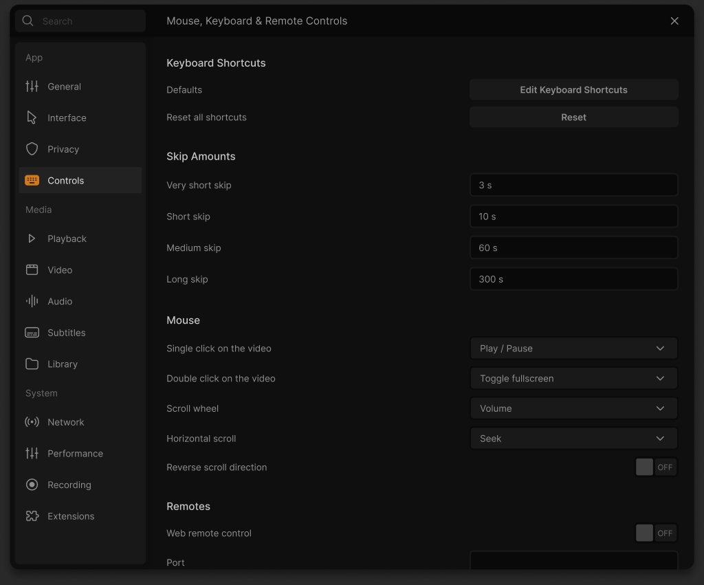

# Original Controls settings reference

One Figma `get_design_context` request on 17 October 2026 retrieved the complete
Controls frame `6536:14482`, including its screenshot. The node is grounded in
the saved 14 October top-level inventory. This consumes the second planned beta
validation request: six planned and two reserved correction requests remain.

Original design and artwork: Juxtopposed, under the existing CC BY 4.0
attribution. The screenshot is reference material. The 18 original SVG downloads
are retained unchanged, with hashes and intrinsic dimensions in
[manifest.json](manifest.json). The archived prototype uses local asset paths;
temporary asset URLs are not runtime dependencies. This is reference capture,
not an implemented or accepted Controls page.

The full context includes all four sections below, including the content below
the screenshot's scroll boundary. Existing shared Settings host, palette,
typed field and modal components must be reused during implementation.

| Section | Original field/action | Authored value | Mapping status |
| --- | --- | --- | --- |
| Keyboard Shortcuts | Defaults / Edit Keyboard Shortcuts | Button | Real editor route and active keymap still need verification. |
| Keyboard Shortcuts | Reset all shortcuts / Reset | Button | Scoped checked reset, conflict handling and live consumer behavior remain open. |
| Skip Amounts | Very short skip | 3 s | Native `extrashort-jump-size`; actual hotkey action and bounds need acceptance. |
| Skip Amounts | Short skip | 10 s | Native `short-jump-size`. |
| Skip Amounts | Medium skip | 60 s | Native `medium-jump-size`. |
| Skip Amounts | Long skip | 300 s | Native `long-jump-size`. |
| Mouse | Single click on the video | Play / Pause | Native embedded-video consumer and supported choices need inspection. |
| Mouse | Double click on the video | Toggle fullscreen | Native embedded-video consumer and supported choices need inspection. |
| Mouse | Scroll wheel | Volume | Native `hotkeys-y-wheel-mode` exists; embedded and separate video consumers must be checked. |
| Mouse | Horizontal scroll | Seek | Native `hotkeys-x-wheel-mode` exists; actual enum mapping must be checked. |
| Mouse | Reverse scroll direction | OFF | No new configuration mapping has been accepted. |
| Remotes | Web remote control | OFF | Native HTTP service exists; complete safe activation, persistence and restart behavior remain open. |
| Remotes | Port | Empty | Native `http-port` exists; native default is 8080. Do not silently equate the blank authored value with an accepted edit. |
| Remotes | Scroll wheel | Volume | Authored duplicate under Remotes; meaning and native consumer remain unresolved. |
| Remotes | Horizontal scroll | Seek | Authored duplicate under Remotes; meaning and native consumer remain unresolved. |
| Remotes | Reverse scroll direction | OFF | Authored duplicate under Remotes; do not silently merge it with the Mouse row. |

