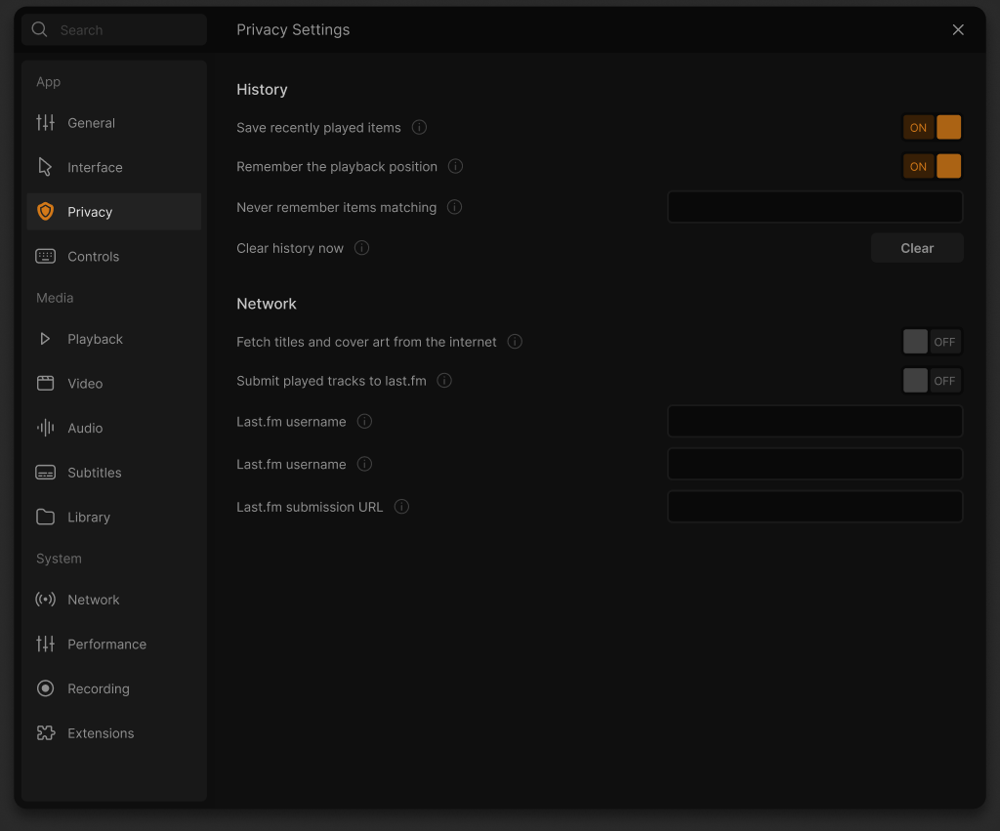

# Privacy reference and native field audit — 17 October 2026

One high-fidelity Figma design-context request for the previously inventoried
Privacy frame `3062:11911` returned the complete code and its screenshot. No
browser-site restriction was bypassed. This consumes one of the eight planned
beta validation calls; seven planned and two reserved correction calls remain.
The original 1048 × 865 frame dimensions come from the saved page inventory.

This is the original design reference, not an application capture. The
[archived context](design-context.json) retains original node IDs, styling and
all nine field/action rows; only temporary asset-source prefixes are normalized
to the adjacent local `assets` directory. The [manifest](manifest.json) records
unchanged screenshot/SVG bytes, hashes and SVG root dimensions. Original design
and artwork: [Juxtopposed](https://www.youtube.com/@juxtopposed), CC BY 4.0; see
[designer attribution](../../../../../modules/gui/qt/pixmaps/juxtopposed/ATTRIBUTION.md).
These archive files remain reference material. The implementation now copies their exact SVG bytes to `privacy-settings-*.svg` application resources, retaining the original dimensions.

The [field map](field-map.json) distinguishes existing native consumers from
missing permissions and services. Remembering a position is a storage policy;
Playback's existing Never/Ask/Always restoration preference cannot replace it.
The obsolete Qt history filter has no current native consumer. Clear needs real
failure feedback, Home activity coordination and protection from stale input or
worker results. Internet metadata must share the existing Library preference.
The Last.fm backend exists, but legacy transport, interface activation, validation
and service behavior remain unaccepted.

The design repeats “Last.fm username” on both credential rows. The backend has
separate username and password options. That mapping is an inference, preserved
as an ambiguity rather than silently rewriting the original label.

The audit found the media-library wrapper discarding `clearHistory()`'s actual
database failure. A native real-database regression and repair are under
[the history-clear checkpoint](../../../native/guest-history-clear-20261017/README.md).
This supplies a reliable native result for the future UI; it does not implement
or accept the complete Privacy controller/page. Search, save/restart/reset,
normal/narrow/light/DPI presentation, all field consumers and final package
verification remain open. Reuse this cache before making another reference call.

The current implementation explicitly adapts the duplicated second credential
label to **Last.fm password**, matching the existing native password option,
and masks its contents. All four Last.fm rows remain unaccepted: new activation
and credential/server editing are unavailable pending secure transport and
service verification. An already enabled legacy submission interface can be
turned off without removing other extra interfaces; restart is required.

The player now has an independent `remember-playback-pos` permission and a
`history-exclude-pattern` consumer shared with Home visits. The rule is a
case-sensitive wildcard substring over URI, decoded local path and item/name;
`*` matches any sequence and `?` one Unicode scalar, with no regex or escapes.
Invalid/overlong input or excessive matching work fails closed. Changed policies
cancel pending writes. Existing accepted history is kept until explicit Clear.
The page's search, save/error/busy/retry and programmatic narrow/light states
are implemented; native desktop/DPI and complete category acceptance remain open.
