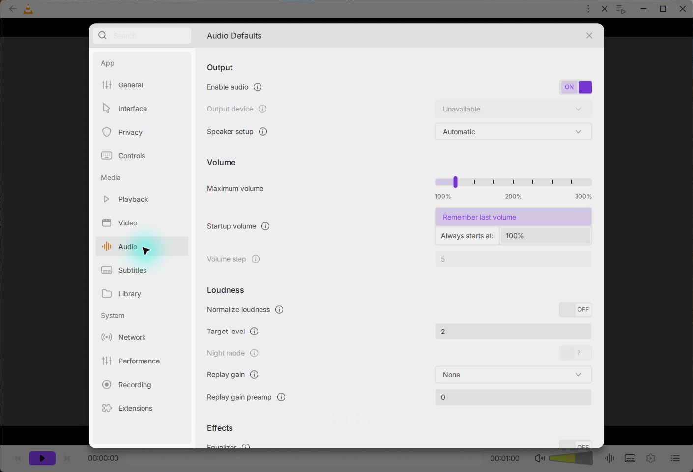
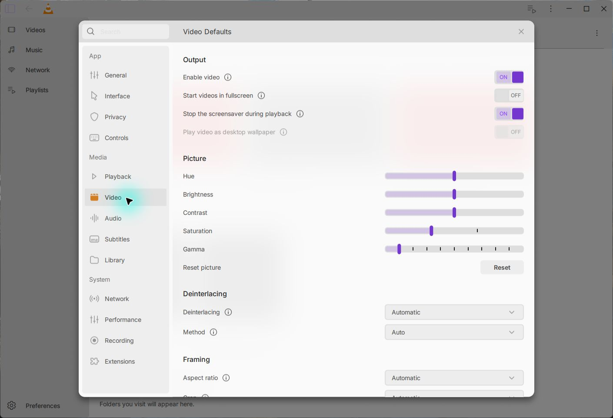

# Native global Audio and Video settings — 15 October 2026

Preferences now exposes separate Audio and Video pages through the existing
General/Interface/Playback host. The Audio page maps 32 native values into the
29 authored rows and expanded eleven-channel equalizer. Video exposes 26 values
and the five-value picture reset. Native choices, checked writes, current-versus-
startup behavior, unavailable capabilities and restart feedback stay explicit.

The ordinary Windows Autotools build succeeds. Registered native results,
including setup/cleanup, are:

| Fixture | Passed / failed / skipped |
| --- | --- |
| Final Audio defaults | 31 / 0 / 0 |
| Video defaults | 23 / 0 / 0 |
| Shared native float store | 9 / 0 / 0 |
| Interface regression | 14 / 0 / 0 |
| Playback regression | 23 / 0 / 0 |
| Existing live equalizer | 5 / 0 / 0 |
| Existing video transforms | 11 / 0 / 0 |

Each accepted run records a completed bounded Windows wait, normal exit 0,
unchanged checked human VLC files and no forced cleanup. The verification keeps
the Qt identity for each run. The final build contains the identical accepted
Video/shared-store/Interface/Playback/controller executables; Audio was extended
and rerun. Earlier Audio 21-case and separate PCM-subset passes overlap the final
31-case suite and are not additional independent coverage.

Audio checks real configuration, types/enums/units, filter-chain preservation,
presets/custom bands, physical persistence, restart and locked-save recovery.
Its PCM case uses VLC's actual native playlist/player with AMEM transport before
output creation. It measures the saved equalizer and live disable without copying
defaults into player variables or rewriting stored defaults. The retained first
run failed one of 21 cases because the separate LibVLC media-player owner
intentionally masked global defaults; the corrected owner preserves all original
RMS bounds and other assertions.

An independent review found rejection of the valid native float minimum for
normalization. The same compiled desired test object reproduces exactly two
real write failures on the original model, with 29 other cases passing. The
corrected native-float comparison passes all 31, including actual float/model
double readback, physical six-decimal bytes and a fresh native instance. Eight
invalid/below-boundary rows still reject without changes. Generic integer bounds
and the common numeric policy are unchanged. The ordinary store object also
passes the original private General desired/policy replays at 29/0/1 and 31/0/1;
the deliberate fault-only skip is covered separately at 3/0/0 with a private
sync/close-fault core. That core is absent from the app. These General replays
are not newly registered General native suites.

Video checks five actual adjust-filter pixel cases, framing, genuine PNG
snapshot format/size/naming, reset across restart and four locked-save recovery
shapes. Its first 22-pass/1-fail result remains preserved: saturated YUV imagery
did not satisfy the reset test's black precondition. The corrected fixture uses
a neutral generated source, retains the original black threshold and colored
post-reset assertions, and adds neutral restoration. The product filter was not
changed to accommodate that fixture. Native Reset API coverage does not accept
the desktop Reset button or a real folder-picker journey.

Visible field errors now stay beside the focused input when scrolled. The same
additive worker rejects both original offscreen banners and passes Audio 16 and
Video 15 groups without Qt messages, preserving the original providers/assertions.
A further display-only correction shows the derived volume step as `5` instead
of `5.000000074505806`. Its final Audio worker passes 17 groups, retaining exact
model values, full-precision explicit edits and no rounded save on focus changes.
Shared-host 24 checks/12 transitions/9 busy guards and software backdrop 23 remain
accepted. These component results use supplied native-shaped services; their
natural/narrow/150%/200% layouts do not establish native display/DPI acceptance.

Three actual desktop journeys on monitor 2 quit normally and preserve the checked
human files. Custom 60 Hz gain -3.5 dB and preamp -6 dB survive restart in the
native model/UI. Invalid pitch 99 restores 0 with visible field feedback. Saving
brightness 0 leaves the paused gray picture unchanged, then the next launch opens
black. Saving brightness 1 leaves that current black frame unchanged; the final
rebuilt app restarts with the original gray picture. Original captured center
pixels are respectively RGB 64/64/64, 0/0/0 and 64/64/64. An invalid snapshot prefix
rolls back with visible feedback. The final app also accepts the exact native
normalization minimum and saves `0.000001`; restoring its original target clears
the restart warning. All three flushed logs lack the checked QML type/reference/
assignment errors. Runtime and source identities are recorded separately.

Build compatibility uses the installed SDK's UUID declarations, complete native
types, explicit byte-string materialization, standard active Automake target
recipes and the actual void snapshot callback. Failed attempts remain private.
The native targets share the actual ordinary checked-store object. Meson is
registered and source reviewed, but has not been built here.

Original design/artwork: [Juxtopposed](https://www.youtube.com/@juxtopposed),
Audio [3073:15879](https://www.figma.com/design/zdNUYRVOH9lEtIxMYvh8DV/VLC-Redesign--Community-?node-id=3073-15879)
and [3180:17398](https://www.figma.com/design/zdNUYRVOH9lEtIxMYvh8DV/VLC-Redesign--Community-?node-id=3180-17398),
Video [3073:14187](https://www.figma.com/design/zdNUYRVOH9lEtIxMYvh8DV/VLC-Redesign--Community-?node-id=3073-14187)
and [3073:15375](https://www.figma.com/design/zdNUYRVOH9lEtIxMYvh8DV/VLC-Redesign--Community-?node-id=3073-15375).
Cached MCP contexts/screenshots and twelve unchanged exported SVGs are reused.
Designer CC BY 4.0 attribution and Inter OFL remain included.

This is bounded native acceptance. Nine Audio controls remain unavailable:
output device, fixed startup volume, volume step, passthrough, Night mode,
Spatial audio/mode, media role and adaptive visualization size. Wallpaper is
also unavailable. Actual picker/Reset UI, complete hardware/codec/effect journeys,
full Figma/Light/Dark/native DPI fidelity, hardware-video backdrop blur,
intermittent Home glyph rendering, remaining categories and a clean licensed
beta package stay open. New-head CI is pending with 28 Windows commands.

[Custom equalizer](assets/audio-custom-equalizer.png) · [Restored custom gains](assets/audio-custom-after-restart.png) · [Visible Audio error](assets/audio-visible-field-error.png) · [Visible Video error](assets/video-visible-field-error.png) · [Accepted native minimum](assets/audio-native-minimum.png)

[Current gray frame](assets/video-current-neutral.png) · [Restarted black frame](assets/video-restarted-black.png) · [Current black frame preserved](assets/video-current-black.png) · [Final restored gray](assets/video-restored-neutral.png) · [Sanitized verification](verification.json)
