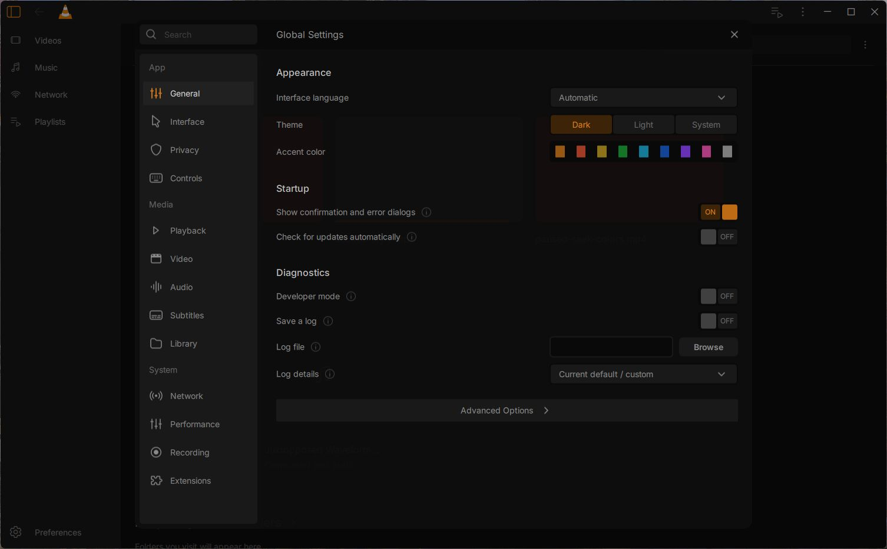
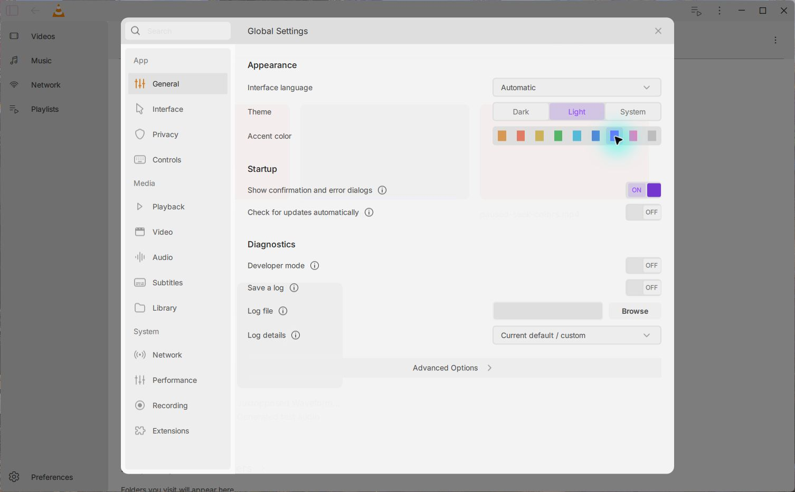

# General Settings checkpoint — 15 October 2026

The native Windows app now opens the redesigned General page through Preferences and Ctrl+P. This is a development checkpoint, with **General as the only enabled category in the new settings dialog**. The other 12 categories remain disabled.

The ordinary native backend run finished with **29 passed, 0 failed and 1 skipped**. The skipped case requires a separate build that injects native sync/close failures; it is not counted as covered by this run.

In the running app, Light mode and the Purple accent applied immediately. After a normal quit and restart, Light/Purple, enabled logging, a Unicode log filename and **Errors only** were restored, and the restart banner cleared. Startup created the selected log file without command-line logging overrides. Advanced Options opened VLC’s genuine native preferences tree, and Cancel returned to the app.

With Settings open over a paused generated video, pressing Space kept the video paused. A fresh followup restored the saved settings again and confirmed that Space outside Settings started playback of the generated chaptered video. Across the two initial runs and that followup, three normal quits completed with exit code 0 and confirmed process termination, without forced cleanup. The checked existing user configuration files remained unchanged; testing used a separate portable profile. These checks do not establish a precise quit latency.

Repository component checks passed **12 General groups and 24 shared-dialog checks**, including 12 modal transitions and nine busy guards, with no Qt messages. The shared-dialog test's first default invocation failed during setup because it located the checkout one directory too high. Correcting that test-script path produced the passing replay with the same providers and assertions. The GNU Make 4.3 regression also produced its expected historical failure and current success for QML, JavaScript and singleton resource dependencies; it does not compile the app.

The captures are original, unedited native-app images. They document the checkpoint rather than final design fidelity. **Backdrop blur/shadow and Light-theme volume styling still need native acceptance. Reset Preferences is unverified. The final clean package and installer are still pending.** This checkpoint does not claim a complete beta or full design parity.

## Native behavior and failure regressions

The MainCtx-owned service writes actual VLC configuration, Qt settings and the
Windows language value. Failed writes restore the previous in-memory values and
report an error. Fresh QSettings sessions recover after a real write failure
without changing the caller's group, fallback or atomic-sync policy. The separate
native policy pair reproduced the original fallback/retry failures and passed
after the repair using the same compiled desired test object.

The core configuration writer now checks flush, close and replacement results;
Windows replacement preserves the old destination when replacement fails. The
separate actual-core fault variant passed its injected sync/close method (three
QtTest passes including setup/cleanup); it was never staged in the app package.
The file logger's explicit error/warning filter is verified for both text and
HTML output. Legacy verbosity remains the default outside the new setting.
These results do not claim power-loss durability or every filesystem variant.

The original native language-cleanup method deleted unrelated parent registry
values. A process-local isolated HKCU pair reproduces that failure and passes
all three preservation rows after limiting cleanup to `Lang`. The static cleanup
receiver also avoids calling through a nonexistent Simple preferences panel.
Actual Reset Preferences still needs its own desktop acceptance.

## Build, tests and provenance

The [source identities](source-identities.json), [native backend](native-backend.json),
[desktop record](native-desktop.json), [language pair](legacy-language-pair.json),
[build/runtime identities](build-runtime.json) and [maintained tests](maintained-tests.json)
retain path-redacted evidence. The incremental ordinary Qt build exits 0 with
DLL SHA256 `10a3a28859f6c2d67ce8aff1a0403e9c07351d8e8a31b59816e9a2ab3bea26f2`.
Post-build changes affect tests/CI, source-distribution lists and preserved
packaging line endings only. The earlier runtime and test profiles remain
recoverable locally.

The first integrated QML build failed because remaking Makefile left an eagerly
expanded included dependency list stale. Deferred target lists now use the
current sources. The tracked real GNU Make 4.3 oracle requires the historical
recipe to fail with a missing new resource prerequisite, while the production
recipe succeeds for added QML, JS, MJS and singleton sources. Both regenerate
the genuine `res.qrc`; this oracle does not compile C++.

The existing nineteen Windows component/source commands remain intact. Two new
General/shared-host commands and a separate Ubuntu make job are added. Native
core/model tests remain distinct from supplied-state component tests and real
app journeys. Complete remote CI for this new source head remains pending here.
Inter's full OFL and designer attribution are copied by the Windows packaging
recipes and staged in the owned candidate; archive/installer inspection is open.
No private picker screenshots, raw logs, human profiles, databases or media paths
are part of the published evidence.
