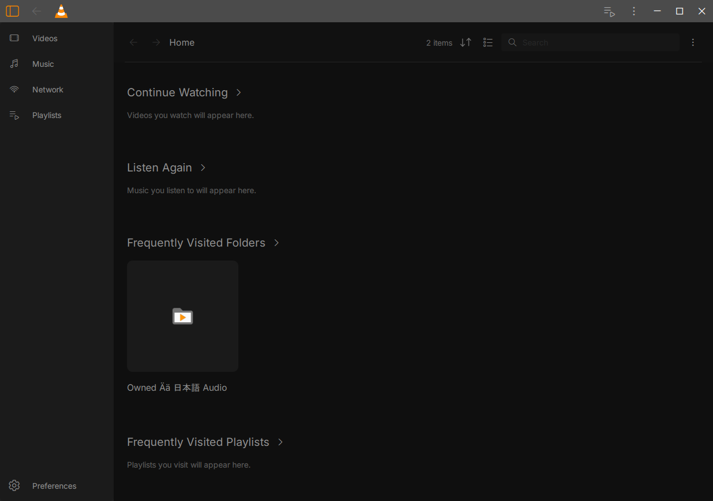
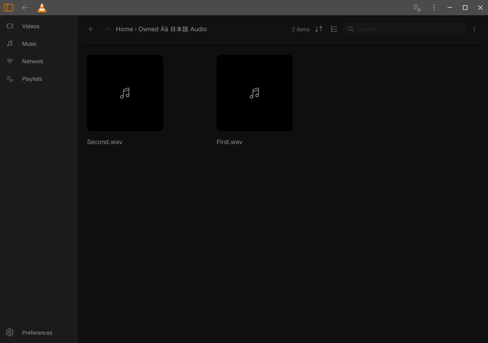
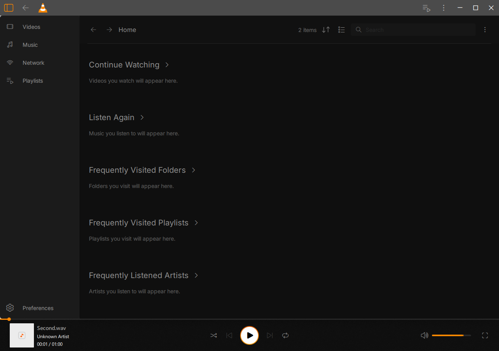

# Native Home audio bootstrap and history — 17 October 2026

Scoped acceptance on the Windows 10 guest. The confirmed redesign and artwork
remain credited to Juxtopposed; VLC and test code retain their existing licenses.
The full beta is incomplete.

The actual Home Add Folder button opens the Qt directory chooser. Cancel adds
nothing. Accepting a generated Unicode E: folder indexes two owned WAV files,
produces a real native folder ID and Home card, and records its first visit.
Actual folder-card, Back/Forward, media-card, music Back and Home-button actions
exercise native indexing, routing and playback. No supplied Home model or
invented database ID is used in these native journeys. Only the generated
folder is a scan root; default personal folders are absent.

The three fresh processes pass **82/140/12 checks (234 total)**. Counts include
repeated target/bounds assertions and are not distinct features. Restart retains
the actual folder ID and observed visit count. The real Privacy toggle prevents
new visits when OFF; the paired ON entry records one visit. Clear History removes
native/local history, retains both indexed files and the one root, and remains
cleared after another process restart. After pausing owned audio and allowing
both clocks to settle, navigation and privacy operations preserve the exact
input, URL, rate and native/UI clocks. All processes exit normally with code 0,
no forced cleanup, no captured fault and zero selected QML/assertion diagnostics.

Reviewing the first native captures revealed two UI defects. Mixed-folder audio
used the video fallback glyph, and audio accessible names contained a mojibake
separator. Three QML files now provide the music glyph for native audio while
retaining video fallback, and use an explicit Unicode em dash in accessible
names. The actual Qt component test fails on the original icon, then independently
fails on the old separator after the icon fix, and passes after both corrections.
Its six new checks cover paired audio/video kind, fallback, accessible names and
activation. The existing Home suite also exercises supplied-model layouts,
scrolling, empty/error states and 250-item virtualization. This component data
is separate from native persistence evidence. Forty-three appearance component
checks pass; no native theme/DPI acceptance is inferred from them.

An incremental ordinary GUI and private test GUI were rebuilt sequentially with
one worker. The final native replay checks actual audio-card fallback glyphs.
Ordinary redesigned, traditional, library-enabled, local HLS and a bounded
read-only Downloads sample all pass normally, with video/audio decoding as
applicable and zero selected QML/assertion diagnostics. The sample's source
size/mtime remain unchanged. Its name, frames and raw logs remain private.
The ordinary package contains no private QA marker; its source runtime and the
original package are unchanged by tests.

Core `bf29403169b936e2156bcfcd0f03a38fbbaad0d9b54fd0e7d9e843e4bdb5bc33`,
ordinary GUI `800199d41ccd7814fcdd49c4233323cdf8678fc5bce43722bc877592381eabf0`.
Full identities and scoped source/producer hashes are in [acceptance.json](acceptance.json).
The pre-build inventory has 1,910 ordinary and five private inputs; all match
again after tests. These are inventories, not counts of compiled source files.
Existing Core/ML code is unchanged. Earlier native regression results retain
their earlier GUI scope; they are not relabeled as a full regression of this GUI.

Work and retained raw evidence are under
`E:\Modding\vlc-juxtopposed\build-windows\beta-home-20261017`:

- Accepted native: `window-r2/verification.json`; private `native-ui-r2`.
- Ordinary candidate: `ordinary-runtime-r2`; playback `ordinary-playback-r3`.
- Component: `component-fixed-r1`; appearance: `appearance-components-r1`.
- Build/input records: `build-r2.sh`, `build-r2-exit.txt`,
  `ordinary-inputs-r2.json`, `ui-inputs-r2.json`.
- The earlier 76/130/12 native pass is a baseline before the two QML fixes.
- Both component negatives are rejected acceptance, retained to demonstrate
  the defects. Ordinary R2 stopped at a copied stale expected-GUI assertion
  before launching VLC. Corrected R3 matches the actual rebuilt GUI and passes.

Reproduce using the E: migration environment, the private
`modules/gui/qt/tests/native_ui/home_journey.mk` recipe and
`run_home_journey.py --package <ordinary-runtime> --qa-gui <private-DLL>
--output-dir <fresh-E-output>`. The runner creates generated audio and isolated
portable profiles. Keep one build or native/media workload at a time. Test hooks
must never be linked into the ordinary GUI. Do not overwrite retained runs.

Remaining gates include the Windows shell-native chooser (this fixture uses the
real non-native Qt QFileDialog), all five Home sections with genuine video,
playlist/artist/history data, playing-state journeys, unavailable/moved media,
rapid changes, broader accessibility/screen readers, native themes/DPI/monitors,
independent design fidelity, Windows 11 and the final clean licensed package.
This record neither establishes a security-trip cause nor accepts the full beta.

