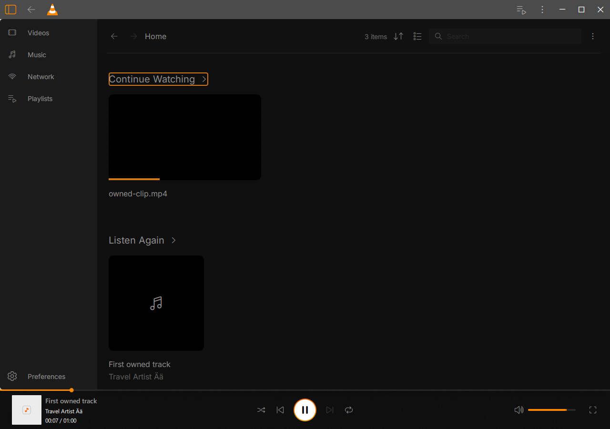
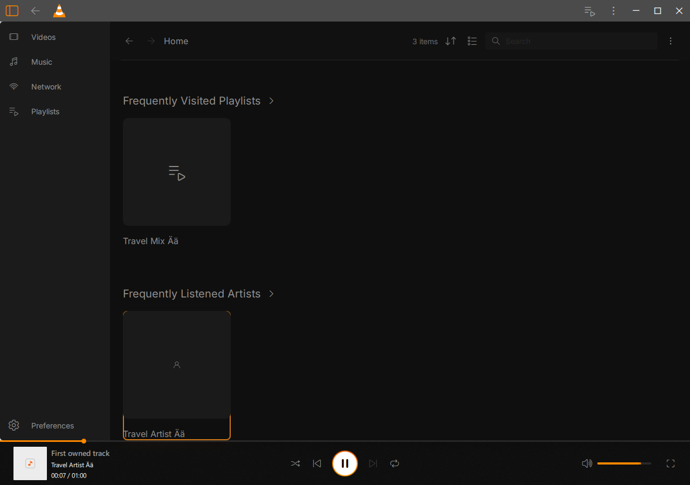
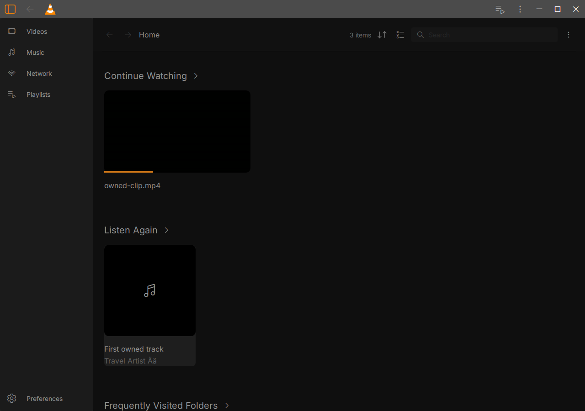

# Native Home content and resume — 18 October 2026

Scoped acceptance on the Windows 10 guest. Jux's confirmed design and artwork
remain credited to Juxtopposed; VLC and the test code retain their licenses.
The complete beta remains unfinished.

All five Home sections now have genuine native test coverage: Continue Watching,
Listen Again, folders, playlists and artists. The actual Add Folder chooser
indexes three generated files in one Unicode E: root. Tagged FLAC files form a
real album/artist. The production File menu opens New Playlist; its real chooser
and Save create a native playlist. Actual card activations, five See All routes,
search/clear and grid/list changes preserve a playing input and advancing clock.
Playlist and artist cards open their actual native content models. Restart keeps
the native IDs and history. No supplied Home models or database writes seed these
journeys. Native seeking/pausing prepares playback; navigation uses actual owned
window input, and the floating preview is moved by a real pointer drag.

The first two plain runs exposed a real resume-loss defect: populate passed
288 checks, but reopen failed at check 12 because the video's stored position
was -1 despite visible playback near one third. Both runs used prior
Corebf2940. Code inspection found that history saved the last raw input position,
which can lag the timer used by the player after a resume and quick pause.
The fix snapshots the valid timer position before detaching a started current
input. Each input keeps its own snapshot; late input events cannot replace it
and a later input cannot supply its timer. Existing history/position epoch and
privacy checks still control whether progress may be saved. Public player APIs
are unchanged; one private input field is added.

Two fresh plain runs on Core0cdebe pass **288/137 checks (425 each)**, including
Continue Watching overriding the global Never preference, pausing after resume,
exact paused input/native/UI-clock preservation, and genuine process restart.
Counts include repeated target/bounds assertions, not distinct features.
The earlier audio bootstrap/privacy journey also passes **82/140/12 (234)** on
this core, including Privacy OFF/ON, Clear History and cleared restart.
All accepted UI processes exit normally, with zero selected QML/assertion
messages, no forced cleanup and no captured native fault.

The content runs use a 1280×900 window with native video auto-resize disabled.
Earlier private attempts targeted outside an auto-resized window or underneath
the intended floating preview. The corrected fixture checks visibility, clipping
and inherited opacity, then drags the preview before activating covered controls.
Those failed attempts establish no product Back/layout defect. Default auto-resize
and small-window geometry remain open. A debugger trace observed four native
progress writes but changed timing and masked the loss; it is diagnostic evidence,
not a substitute for the two plain negatives and two plain fixed passes. It did
not observe the hypothesized stale zero directly.

Current-core regressions pass normally:

- Library metadata18/opening42/process9, freshly built from current sources.
- Privacy17 and real database-controller failure/retry18 (Library ON and OFF).
- Queued history clear40/52 with fresh private-layout helper; six actual decoded
  save/resume/before-start/after-stop/position-off/history-off processes.
- Five upstream player programs: lifecycle, pause, seeks, media and timers.
  Prior-core pause/timer controls also pass with the same complete test fixture.
- Native subtitle preferences/rendered-pixel38 with unchanged renderer identity.
- Ordinary redesigned, traditional, Library, local HLS and bounded read-only
  Downloads sample: five normal exits, actual decoding as applicable, zero selected
  diagnostics and unchanged source runtime/package. Personal paths, frames and raw
  logs are retained privately. No private QA module is shipped in that runtime.

The subtitle executable predates the Home-only GUI change; its relevant subtitle
sources and renderer are unchanged and it loads the recorded current ordinary
runtime. Older unrelated UI/controller suites retain their historical scope.
These results are not a full latest-GUI or full-beta regression claim.

Two test/setup issues were resolved separately. E: became full while copying a
Library runtime, before that process launched. Only this turn's verified identical
owned binary duplicates were consolidated, recovering about 7.47 GiB; logs, data,
original archives and earlier evidence were retained. The maintained Library
runner now hard-links immutable binaries, detaches private replacements before
writes and verifies package preservation. The subsequent complete69 pass uses
that runner. Upstream player tests overwrote their Windows plugin path with a
Linux build path and lacked the uninstalled mock demuxer. Windows also does not
load their EXE's static audio fixture. The test header now accepts an explicit
VLC_TEST_PLUGIN_PATH; the native private runtime stages the mock demuxer and a
dynamic build of the same test audio/resampler source. The final five programs
pass without the earlier missing-audio errors. The matching prior-core controls
resolve these failures as setup issues. Test-only libssp is staged from the
existing E-hosted compiler; no dependency installation was needed. The private
module's first compile failed on a duplicate name declaration and is rejected.

Runtime identities:

- Core: `0cdebe2f6950939228eac94304393ef946b1947c80d1cbb8a8f83abe546a8072`
- Ordinary GUI: `800199d41ccd7814fcdd49c4233323cdf8678fc5bce43722bc877592381eabf0`
- Media library: `e3ec5ed46c8abb561c99c45864261efb003abfa276ee9b341a50bacfba213c0a`
- Freetype: `d102b09767056a9acb6ab3b007c653c9561dba17857d5a8258d07242a5856ceb`

The GUI and media-library binaries are reused unchanged from the previous Home
checkpoint. The core is incrementally rebuilt. [acceptance.json](acceptance.json)
records scoped results and source/binary identities; frozen source/producer
inventories are alongside it. All458 core, five private-UI,25 relocated-player,
three mock, six dynamic-test and two history-helper entries still match. The
1910/1939 broader inventories differ only in the explicitly changed Library
runtime-staging Python file and native UI README, which are not compiled GUI/core
inputs. Inventories are not counts of compiled source files.

Raw evidence remains under
`E:\Modding\vlc-juxtopposed\build-windows\beta-home-content-20261017`:

- Accepted UI: `window-core-r1`, `window-core-r2`, `home-audio-core-r1`.
- Candidate: `ordinary-runtime-core-r1`; core build `build-core-r1`; private GUI
  `native-ui-r3`; ordinary playback `ordinary-playback-core-r1`.
- Regressions: `library-*-core-r2`, `privacy-core-r1`, `history-clear-*-core-r2`,
  `history-playback-core-r1`, `player-relocated-r3`, `standard-subtitles-core-r1`.
- Final continuation: `regression-core-r4/verification.json` is terminal/pass.
  Earlier regression R1/R2/R3 reports retain setup/loader/timeout failures.
- Plain resume negatives: `window-fixed-r2` and `window-fixed-r3`.
  `progress-trace-r3` is the activated debugger trace; R1/R2 had no breakpoint proof.
- Storage: `storage-compaction*.json`; rejected player fixtures:
  `player-relocated-r1`, `player-relocated-r2`, `player-timers-comparison-r1`.

Reproduce through the E: migration environment, one job at a time. The private
`home_content_journey.mk` and `run_home_content_journey.py` are maintained in
`modules/gui/qt/tests/native_ui`. Run with `--package <ordinary-runtime>
--qa-gui <private-DLL> --fixtures <generated-fixtures> --keep-window-size
--output-dir <fresh-E-output>`; retain both default populate/reopen processes.
The [reproduction directory](reproduction) preserves exact guest build/test
recipes and the derived dynamic upstream fixture. They are snapshots with
retained output names: choose fresh output names before replaying. Never overwrite
a DLL while any retained runtime hard-links it. The FLAC recipe is recorded;
`owned-clip.mp4` reuses the generated60-second subtitle-style video from
`beta-presets-20261017/fixtures-native-r1/subtitle-style.mp4`.
[Fixture hashes](fixture-sha256.json) identify the actual bytes used.

Remaining gates include unavailable/moved media, rapid changes, default/narrow
window geometry, actual Windows shell-native chooser, broader native themes,
keyboard/screen readers, DPI/monitors, independent design fidelity, Windows11
and a final clean licensed package. This checkpoint establishes no security-trip
cause and does not accept the full beta.

