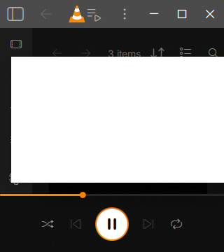
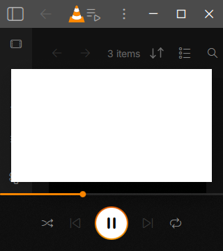
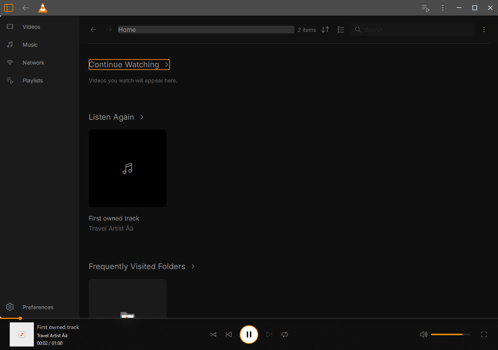

# Native default-resize Home and preview — 18 October 2026

Scoped acceptance on the Windows 10 guest. The confirmed redesign and artwork
remain credited to Juxtopposed; VLC and test code retain their existing licenses.
The complete beta remains unfinished.

Default video auto-resize makes the generated 320×180 video use a 320×360 window.
Actual video Back/Home navigation and Return activation still work there, but
the floating preview extended 16 pixels beyond the right edge. The explicit
native negative records its rectangle as **[16,81,320,180]** in a 320×360 window.
The ordinary GUI now keeps the preferred 320 dp width when space permits and
scales it to the available library width at smaller sizes, retaining 16:9.
The fixed actual rectangle is **[16,99,288,162]**. Canonical-window preview size
and real pointer dragging remain functional. The bounds assertion concerns
video content; shadow effects are not treated as overflow defects.

The fixed native suite passes **288/137/112 checks (537 total)** in three fresh
processes. Populate/reopen retain the prior genuine all-five-section content,
actual New Playlist/artist models, playing/paused navigation and resume/restart
journeys. The separate edges process uses actual default video auto-resize,
checks real Back/Home, keyboard Continue Watching and preview bounds, then
explicitly resizes to 1280×900 for independent file-availability checks.
Counts include repeated target/bounds assertions, not distinct features.

Only an inactive generated video is temporarily moved outside the one owned scan
root, within the same isolated E: output. Native reload removes it from Home and
reports two media. The other real audio input, state and advancing clock remain
unchanged. Restoring the exact original file and reloading restores three media;
the actual folder card plays that video again. All three generated file hashes
match their sources afterward, and the temporary parked path is absent.

Native rescanning reindexes the returned video: the final owned database has
media IDs 1/3/4 (audio/audio/video), rather than the original three sequential IDs.
This does **not** accept preservation of the old media identity or its history
across absence/rescan. Locating a source at a different path, unavailable parent
folders and history-preservation behavior remain separate cases. The current
Home behavior removes the unavailable video rather than retaining a disabled
video tile; no broader unavailable-state design acceptance is inferred.

Eight requests 60 ms apart exercise **MediaLib::addAndPlay(const MLItemId&)**,
the same asynchronous native-ID lookup overload used by Home. Both IDs are
queried from the real indexed audio. The final request settles on second.flac,
with actual audio/no video and an advancing native clock. These are native
controller requests, not eight pointer-driven UI journeys. The earlier prepared
URL-overload variant was replaced before positive acceptance because it would
not exercise Home's asynchronous lookup path.

All three accepted native processes exit normally, with zero selected
QML/assertion diagnostics, no forced cleanup and no captured native fault.
Ordinary redesigned, traditional, Library, local HLS and a bounded read-only
Downloads sample also pass: five normal exits, actual decoding as applicable,
zero selected diagnostics, unchanged source runtime/package and unchanged sample
stat. Personal paths, frames and raw logs remain private. No QA marker or
private test module is shipped in the ordinary runtime.

The ordinary GUI was incrementally rebuilt with debug sections stripped,
producing 105,056,761 bytes without adding QA code. This saves space for future
E: test staging. Original binaries and raw evidence remain retained. It is not
a final clean beta package. Core and media-library binaries are unchanged:

- Core: `0cdebe2f6950939228eac94304393ef946b1947c80d1cbb8a8f83abe546a8072`
- Ordinary GUI: `b9b9f341d8ed60c659a0d006244ac7cfe9dd86848cf99d6f366fcb433fb0e1a7`
- Media library: `e3ec5ed46c8abb561c99c45864261efb003abfa276ee9b341a50bacfba213c0a`

All 1,912 ordinary source/producer and six private entries match after tests.
The prior 458 core entries also match. These are inventories, not counts of
compiled files. [acceptance.json](acceptance.json) records scoped identities,
negative/fixed geometry, process results and explicit limits. The previous
[Home/resume checkpoint](../guest-home-content-resume-20261018/README.md) retains
its backend/Privacy/Library/subtitle/player results with GUI800199; those are not
relabeled as a complete regression of this new GUI. Only MainDisplay's preview
sizing is changed in production here.

Retained raw work is
`E:\Modding\vlc-juxtopposed\build-windows\beta-home-edges-20261018`:

- `window-r2`: populate 288 passes; edges 33 fails at the explicit bounds assertion
  with normal exit. Production QML was unchanged for this negative.
- `window-r4`: accepted populate 288/reopen 137/edges 112; `native-ui-r4`.
- `ordinary-runtime-r1`, `ordinary-runtime-r1.json`, `ordinary-playback-r1`.
- `build-ordinary-r1` and private R1/R2/R3/R4 builds all terminate normally.
  R3 reused the negative fixture object and was retained without execution;
  R4 recompiles the stronger native-ID variant and supplies positive acceptance.
- R1's edges 51 failure clicked the floating preview over an audio card after
  resizing. It is a rejected fixture assumption, not an audio activation defect.
  R2 corrects that setup with the real preview drag before covered controls.

Use the E: migration environment and one build/native/media workload at a time.
[Reproduction snapshots](reproduction) retain the exact ordinary flags, native
recipes, immutable staging and final launch. The maintained fixture is
`modules/gui/qt/tests/native_ui/home_content_journey.cpp`; its runner takes
`--package <ordinary> --qa-gui <private-DLL> --fixtures <generated-three-file-set>
--keep-window-size --modes populate reopen edges --output-dir <fresh-E-output>`.
The keep-size option affects populate/reopen; edges deliberately uses default
video resizing and records that separately. Generated fixtures and their hashes
are retained in the preceding checkpoint. Choose fresh output names before
replaying the snapshot scripts. Never overwrite a linked retained DLL.
The preserved negative C++ snapshot matches its frozen input hash; compiling
that snapshot against the original GUI objects reproduces the explicit bounds
check without requiring the later rapid-ID extension.

Remaining gates include complete narrow pointer interactions, broader native
themes/keyboard/screen readers, DPI/monitors, moved/new-path and parent-folder
cases, fuller rapid UI changes, ordered heterogeneous sidebar pins and the
remaining confirmed redesign surfaces. Independent design fidelity, Windows11
and a coherent clean licensed beta package remain open. This checkpoint
establishes no security-trip cause and does not accept the full beta.

