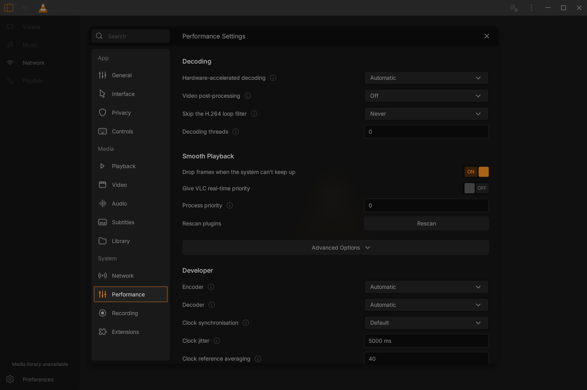

# Performance page and native consumers — 17 October 2026

All fourteen original Performance fields/actions are mounted in the real
MainCtx/settings host. The original nineteen SVG assets are unchanged. Native
policy, checked persistence and the actual compiled window have focused
acceptance; full beta, full regression and Windows DPI/platform acceptance remain
open. See [verification.json](verification.json) for exact binary identities.

The native controller passes **17 ordered Qt cases**, including Unicode save,
compound postproc preservation, strict types/bounds, a real locked config file,
Windows class readback/rollback/retry, saved but unapplied real-time requests,
command-line precedence and full-inventory rescan. A paired older-model run
fails the new pending-request case and remains rejected. This account refuses
exact real-time priority; the granted path is not verified.

The actual owned native window passes **51 editing and 14 restart checks**,
with normal exits and the settings popup still open at quit. This includes
pointer/key targeting, real native saves, failure/retry, process-class restoration,
Rescan and Advanced disclosure. These checks include targeting assertions, not
65 distinct features. The private GUI adds one QtTest translation unit to the
ordinary production objects; ordinary VLC ships no fixture. Regex JIT is
explicitly enabled during acceptance.

Actual media tests pass **11 software cases** using a small generated H.264
transport stream. The real decoder context logs all five loop-filter policies
and thread counts; native input/vout logs confirm clock jitter, reference
averaging, pacing and frame-dropping. Postproc confirms inline quality precedence.
Explicit/incompatible/missing preferred decoders follow native selection and
fallback. Every case produces a decoded PNG and exits normally.

Three additional short read-only tests on compatible offered media pass:
Automatic and selected Direct3D 11 device both use D3D11VA; Off preserves the
device preference and uses software decode. Source size/time remain unchanged.
Raw sample paths, logs and frames stay private. This does not establish a codec,
media or hardware matrix. Encoder selection/job-snapshot and rescan lifecycle
have their own earlier native proofs.

Ordinary VLC passes **five bounded playback cases**: redesigned and traditional
video/audio/subtitles, Library enabled, local HLS and a Downloads hardware sample.
There are no observed QML, file-write, missing-visual-callback or PCR-match errors
in the generated playback cases. Source runtimes/package are unchanged.
Component checks pass Performance6, Network7 and Controls8 groups. Their narrow,
Light and 150% captures are programmatic layout checks, not Windows DPI proof.

The first native-window attempt passed its 51 actions but crashed on quit and is
**rejected**. A controlled debugger caught Qt PCRE JIT thread-local cleanup;
disabling JIT only for diagnosis shut down normally. Equivalent manual ASCII
validation now replaces this model's simple option-name regex. Corrected native
runs pass with JIT enabled. The earlier Windows report mapped a different
MainCtx site; this is not a general guarantee about all Qt shutdown paths.
The initial MPEG-TS consumer test incorrectly required one decoder creation;
VLC legitimately reopens after SPS/PPS format discovery. That failed attempt is
retained. The maintained test requires every selected decoder and every policy
observation to match. A wrong device module name and a missing private-build
argument also remain rejected, never relabelled as acceptance.

Frame dropping requests a restart because VLC can reuse its video output.
Hardware/postproc also request restart; other decoder/clock changes apply to the
next input, encoder defaults to the next automatic conversion, and priority
applies live only after exact readback and successful checked save. Unsupported
and command-line-overridden preferences remain explicit.

The incremental Autotools build ran with one worker; all **2,212 frozen inputs**
matched afterward. Three Meson files parsed, with the pre-existing duplicate
link_args warning in src/meson.build. A native Meson or clean release build is
not claimed. Debug sections were stripped from these large guest GUI outputs.
Public text is UTF-8/LF. The manifest records public hashes; verification retains
the raw evidence hashes separately. Earlier failure directories remain intact.

Reproduce with [native_performance_preferences.md](../../../../test/libvlc/native_performance_preferences.md)
and [native_performance_consumers.md](../../../../test/libvlc/native_performance_consumers.md).
Recording12, Extensions7, remaining designed consumers/native journeys,
theme/accessibility/platform checks and a coherent clean licensed package still
belong to the active redesign beta goal. Vanilla-only parity is V1.0; tentative
new integrations belong to V1.5.
