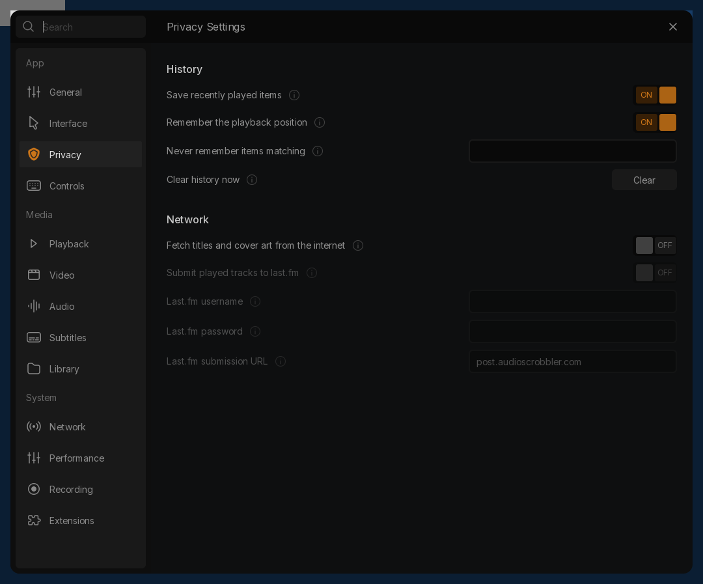

# Privacy policy implementation — 17 October 2026 guest

This is an implementation checkpoint toward the full beta. The complete Privacy
category, native GUI integration, desktop/DPI/Windows 11 and final package gates
remain open. The final incremental GUI and scoped native/ordinary regressions below now pass.

The nine original rows are now mounted in the existing settings host. The page
uses the archived original SVG exports byte-for-byte at their intrinsic sizes,
shares existing palette/focus/modal controls, and adds honest save/error/busy/
retry/restart states. The duplicated second username label is explicitly adapted
to the native password option with a masked **Last.fm password** field. The
original reference and labels remain archived under the [Privacy reference](../../figma/20261017/privacy/README.md).

The independent `remember-playback-pos` permission controls automatic position
storage/restoration without changing Playback's Never/Ask/Always enum. History
OFF prevents automatic per-media writes, including insertion of unknown external
media; explicit favorites and named playlists remain intact. Remember OFF can
still record recent activity with no resume position. `history-exclude-pattern`
is a bounded case-sensitive wildcard substring over URI, decoded local path and
name (`*` any sequence, `?` one Unicode scalar; no regex/escapes). Invalid or
excessive input fails closed. The same matcher is used for Home folder/playlist
visits and accepted Open Network addresses. Policy changes cancel pending writes;
enabling applies to newly opened playback inputs. Existing history is preserved
until explicit Clear.

Player-coordinated clear propagates real database failure, preserves current
playback/queue, invalidates delayed position restoration and prevents current or
retiring inputs from writing cleared activity back. The Qt service clears Home
visits and interface history only after native success, reports partial local
store failure accurately and permits retry. Its worker is joined before borrowed
player/library/settings teardown. Open Network now saves only accepted opens
under the current history policy; widget destruction does not rewrite cached URL
history. This closes the cached opt-out/clear resurrection path.

A newly exposed native crash occurred when Clear was the **first** operation on
an uninitialized library. The control-query wrapper now initializes the library
before its SQLite transaction. With the exact same initial Qt test executable and
core, changing only the ML DLL replaces an access-violation exit with 11 normal
passing cases: [fresh-library-crash-pair.json](fresh-library-crash-pair.json).
This was an owned test-process crash; Windows did not crash. The native regression
now explicitly performs Clear before any Get/List/seed operation. Its 40 checks
include real SQLite UPDATE rejection, unchanged checked data on failure, retry,
restart, wildcard/Unicode cases, independent storage policy and real retiring-input
shutdown: [native-history.json](native-history.json). These input persistence
cases exercise actual player inputs/ML writes, including constructed inputs; they
do not stand for a full decoded-playback/desktop history journey.

New Last.fm activation and credential/server editing remain unavailable pending
secure transport/authentication/service implementation and verification. The
bundled backend builds legacy HTTP requests and expects a host. Last.fm documents
that [its old submissions protocol is deprecated](https://www.last.fm/api/submissions)
and its [desktop authentication flow uses user authorization and an application API key](https://www.last.fm/api/desktopauth).
Removing an already enabled `audioscrobbler` interface preserves other extra
interfaces and requires restart; this was tested at the configuration level.
No personal credentials or listening history were submitted.

The final programmatic host/page fixture passes **8 groups** with zero QML
diagnostics: typed edits, rollback feedback, busy/failure/retry, search, exact
archived SVG bytes/slots and narrow/light states. Captures are offscreen component
evidence, **not** native desktop visual/DPI acceptance. The native controller
passes **14 QtTest cases**, including genuine locked-file rollback, fresh startup
reads, external preference reload, live network-history opt-out/exclusion,
preserving native extra-interface option blocks and worker teardown with queued
event processing. The same executable passes **9 real-database failure/retry
checks** in opt-in pipe mode. On SQLite rejection it reports an error, preserves
the player generation and leaves interface history untouched. Retry clears all
stores before reporting success. A later local-store failure reports partial
success honestly; no cross-store atomic rollback is claimed.

The final ordinary runtime passes redesigned/traditional playback, redesigned
Library-enabled startup/playback and local HLS: normal exits, decoded frames/
Direct3D 11/WASAPI where applicable, zero QML/write/visual/PCR errors. Unchanged
native Library fixture executables pass **18/42/9** and Subtitle preferences
**37** with the final core/GUI/ML tuple, no failures/errors/skips or forced cleanup.
All 1264 frozen Qt source/resource/test hashes match after the final build.
This is an incremental compatible runtime, not the final clean licensed beta
package. Core is `dd8c11…9186`, GUI `fe5d00…0c81`, ML `0a9d2d…44e0`; unchanged
SoXR is `4934e6…ad16`. See [verification.json](verification.json),
[ordinary-verification.json](ordinary-verification.json), [native-controller.json](native-controller.json),
[library-regression.json](library-regression.json) and [subtitle-regression.json](subtitle-regression.json).



Reproduce in a matching configured native build and owned portable runtime:

```sh
make -C <build>/modules -j1 libmedialibrary_plugin.la
make -C <build>/src -j1 libvlccore.la
make -C <build>/modules/gui/qt -j1 libqt_plugin.la
make -C <build>/test -j1 test_modules_medialibrary_history.exe
make -C <build>/modules/gui/qt -f Makefile -f <repo>/modules/gui/qt/tests/native_library/privacy.mk -j1 PROPOSAL_OUT=<fresh-test-output> privacy-preferences-native
```

Stage matching test executables/DLLs and compiler support DLL where required:

```powershell
python test/libvlc/native_history_clear.py --package <owned-test-runtime> --output-dir <fresh-output>
python modules/gui/qt/tests/native_library/run_privacy.py --package <owned-test-runtime> --output-dir <another-fresh-output>
```

The controller runner performs normal tests and real SQLite rejection/retry
sequentially. Both build-system registrations are maintained; Meson syntax
parses, but no native Meson build is claimed.

Open gates include actual native Home/legacy-dialog clear/visit journeys,
Library-disabled playback-history/clear semantics, secure Last.fm service,
all original fields/remaining five category bodies, native desktop/visual/DPI
review, Windows 11 and final clean-package acceptance. Clear currently requires
an active media library, including when interface URL history exists. Unavailable
controls and component captures do not finish the beta. Baseline/prior runtimes
and the five unrelated untracked files remain preserved. No personal credentials
or listening history were submitted.
