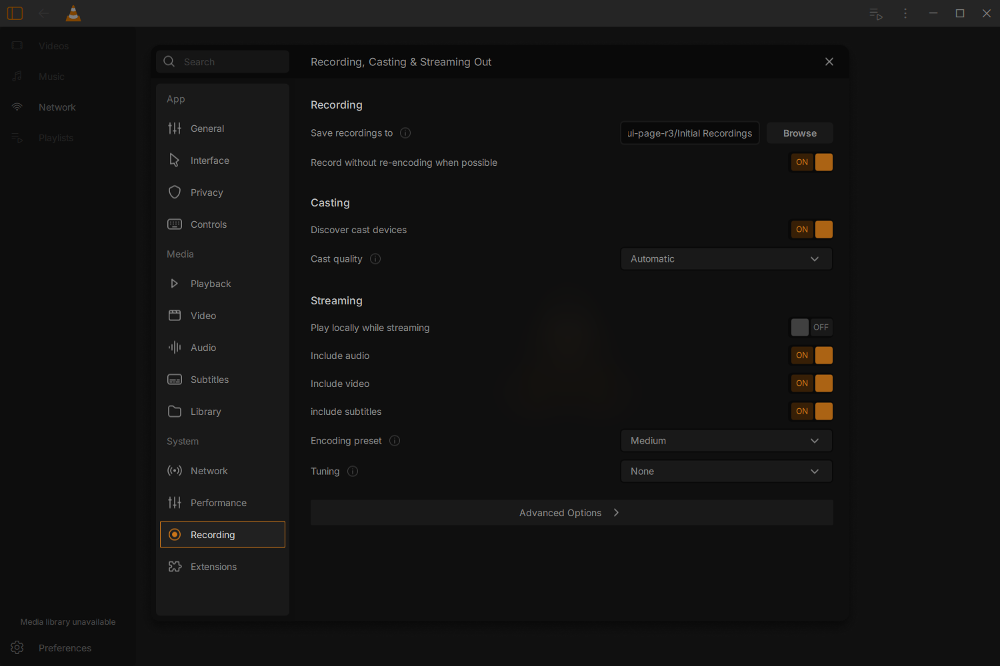

# Recording page and native consumers — 17 October 2026

The real MainCtx/settings host now mounts all **12 original fields/actions**
from Juxtopposed's Recording reference, with its 19 unchanged SVGs. Source is
`f31b2ecce8d7a83ea6ec125d460f2d87fda7e841`. This is focused functional acceptance;
the complete redesign beta and its final quality/package gates remain open.
Exact binary identities and limits are in [verification.json](verification.json).

The user approved preserving VLC's native recording preference. The original
checkbox label remains intact; screen-reader and ordinary hover/focus help
explain that OFF uses the normal copy/remux fallback and does not force an
encode. Native Medium and None encoder defaults remain usable. Saved custom
values, unavailable capabilities, command-line overrides and application timing
stay explicit rather than selecting an optimistic preset.

The native model passes **14 ordered Qt cases**, including lifecycle cases,
Unicode persistence, typed options, real locked config/INI rejection and retry,
discovery notification only after accepted OFF saves, and CLI precedence.

The actual compiled owned window passes **87 editing and 15 restart checks**
in two normally exiting processes, with regex JIT enabled. These include
targeting assertions, not 102 distinct features. The real QFileDialog route
cancels and accepts a Unicode folder in Qt widget mode. Native saves reject and
retry a locked file; all quality choices, independent output flags, Fast and
cleared tuning persist. Real mDNS discovery starts, and accepted OFF stops it
while preserving an owned player renderer selection. No live receiver was used.
The actual Stream wizard reads the local-output default, retains its snapshot,
honors explicit checkbox changes in its real chain, and reads the changed
default in the next wizard. Advanced opens the existing native expert view.
Both processes have no observed QML diagnostics.

Actual media checks pass **two recording modes**, each writing one playable
file into a Unicode/space folder through the LibVLC recording API. Logs confirm
the original-stream and normal fallback backends; both outputs decode to PNGs.
Eight real stream cases verify all tracks, individual exclusions,
subtitle/audio/video-only output and explicit CLI precedence. Matroska metadata
and an owned SRT packet verify the result. The Core no longer suppresses streamed
SPU with video OFF; MKV advances its container clock when A/V are unselected,
so subtitle-only output and time limits work. Local subtitle/video gating stays
intact. Offered media paths, raw logs, clips and frames remain private.

Seven actual x264 jobs verify unset Medium, saved presets, zero-latency tuning,
clearing None, and profile/CLI precedence. Parameters read back from the open
encoder verify threads, CABAC, B-frames and lookahead. Every two-second output
decodes successfully and exits normally.

Focused regressions pass **11 software and three hardware media cases**,
ordinary playback5, Subtitle37 and component Recording6/Performance6/Network7/
Controls8. Hardware Automatic/selected device use D3D11VA; OFF preserves the
device choice and uses software. Subtitle37 records the new Core/MKV with the
earlier staged GUI; final GUI coverage is the separate window and ordinary
checks. Backend-only suites retain their own tuples and do not load the GUI
frontend. This is not a fresh complete regression or a format/hardware matrix.

Rejected attempts remain rejected. Older consumers dropped SPU with video OFF
and timed out with subtitle-only MKV. The earlier model fails the new default/
None case. An initial replay deadline was shorter than its accidentally
60-second output; bounded fixture generation fixed that test setup. The first
window test assumed the wrong native subtitle default; the next clicked the
center of a wide checkbox outside its active label/indicator. The corrected
replay verifies the visible indicator and both actual chain changes. Both
earlier window failures exited normally. See [rejected-attempts.json](rejected-attempts.json).

All **2,285 frozen inputs** match. The serial incremental Autotools build and
standard native test target resolve; three Meson files parse with the existing
duplicate link_args warning. Native Meson and a clean release build are not
claimed. The ordinary GUI contains no private QA marker or fixture module.
Public text is UTF-8/LF; raw and published hashes are kept separately.

The canonical window and narrow/scaled component captures were inspected.
Shared Light search-placeholder contrast, complete theme/accent/system changes,
Windows native file-dialog behavior, Windows DPI/multimonitor/Windows11,
live cast receiver coverage, remaining designed consumers/journeys and a clean
licensed beta package remain open. Extensions7 is the next settings body.
Vanilla-only parity is V1.0; new integrations are tentative V1.5 candidates.

Reproduce with [native_recording_preferences.md](../../../../test/libvlc/native_recording_preferences.md)
and [native_recording_consumers.md](../../../../test/libvlc/native_recording_consumers.md).
