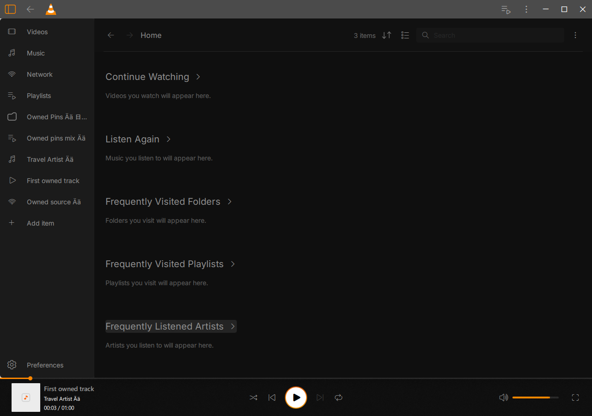
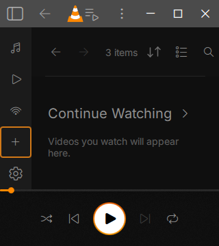

# Ordered sidebar pins — scoped Windows checkpoint

18 October 2026. Functional checkpoint, **not full sidebar or beta acceptance**.
All work, runtimes, fixtures and output stayed on E:, with one heavy task at a time.

The redesigned sidebar previously had no pin section. It now uses one MainCtx-owned
native model with typed media, folder, playlist, artist and source descriptors.
Media/folder/source identities use normalized addresses; native collection IDs
remain exact decimal strings and are guarded by database file identity. Manual
pins are independent from favorites and viewing/listening history.

Successful saves precede visible model changes. Ordering survives restart;
duplicates retain their identity, and failed saves retain the accepted state for
explicit retry. Native collection lookups serialize additions in request order.
The virtualized sidebar provides Add, context Open/Move/Unpin, keyboard traversal
and Control-Up/Down. Home cards expose Pin to sidebar. Local/source folder pins
use genuine native browsing trees, independently of media-library indexing.

## Accepted evidence

| Check | Result |
| --- | --- |
| Native owned windows: populate / restart / library OFF / replacement DB | 203 / 70 / 68 / 72 checks, all normal exit0 |
| Native checked store, including a genuinely cold child reader | 22; no failure/error/skip/warning |
| Actual sidebar QML with explicit supplied model | 19 checks, including 60 virtualized rows |
| Existing navigation / Home component / appearance | pass / pass / 43 |
| Ordinary modern, traditional, library, local live and read-only Downloads sample | five cases pass normally |
| Frozen ordinary / private / store inventories | 1,916 / five / eight entries unchanged |
| Previous Core inventory | 458 entries unchanged |
| Meson | syntax parsed; native Meson build not run |

Counts include fixture and UI assertions; they are not counts of distinct features.
See [acceptance.json](acceptance.json), [native-window.json](native-window.json),
[store.json](store.json), [ordinary-playback.json](ordinary-playback.json) and
[component.json](component.json) for exact scope and identities.

The native journeys exercise actual Add pickers, the Home media context action,
keyboard/native-menu ordering, volume-shortcut isolation, locked-preferences
unpin rollback and same-process Retry. Folder/source rows enumerate the generated
files through NetworkMediaModel. Playlist/artist rows open their exact typed
native content models. Browsing preserves the playing input and advancing clock;
collection navigation preserves the paused input, native clock and position.

The queued playlist/artist/source additions use genuine native-controller setup;
they are not claimed as three pointer-driven creation journeys. The actual source
address dialog and duplicate handling are also exercised. No test data or private
GUI hook is shipped in the ordinary runtime.

A native coordinated history clear preserves the manual pins. An absent inactive
owned file remains represented, reports unavailable, can be unpinned through its
actual menu, and is restored byte-for-byte. A fresh process preserves all five
mixed descriptors, order and Unicode. With the library OFF, local pins still
play/browse and collection pins report unavailability. A fresh database really
reuses the saved playlist and artist IDs; its pins cannot silently open those
new collections. An unrelated navigation cancels a pending collection activation.
All generated media and supplied ordinary binaries remain unchanged.

Current ordinary candidate:
`E:\Modding\vlc-juxtopposed\build-windows\beta-sidebar-pins-20261018\ordinary-runtime-r6`

| Binary | SHA-256 |
| --- | --- |
| Core | `0cdebe2f6950939228eac94304393ef946b1947c80d1cbb8a8f83abe546a8072` |
| Ordinary GUI | `a7af1c45bf98061735baee09562ba04ab1a69d8dbf436a664b00d4391a03c2ad` |
| Media library | `e3ec5ed46c8abb561c99c45864261efb003abfa276ee9b341a50bacfba213c0a` |

The 105,469,098-byte ordinary GUI has no private QA marker. This is an incremental
candidate, not a clean release package. Earlier Core/Library/Privacy/subtitle/player
regressions retain their recorded earlier GUI scope; they are not relabeled here.

## Reproductions and corrections

- A real cold child rejected the first QVariant-container representation even
  while the writer's shared INI cache looked correct. Versioned JSON text fixes
  the round trip without depending on QVariant stream registration. Large IDs,
  Unicode, malformed/future data, grouped/fallback settings and file locks are checked.
- The first virtualized list intercepted Down instead of allowing sidebar focus
  traversal. Explicit sidebar key routing fixes it. The exact frozen negative QML
  reproduces the failure with the same test; [negative control](rejected-attempts.json).
- An unnamed MLItemId C++ signal argument prevented the QML collection handler
  from connecting. Naming every signal argument fixes the real window journeys.
  Strict ordinary/native diagnostics now reject that warning and syntax errors.
  The earlier cancellation-only change did not fix this failure. Actual navigation
  remains the tested supersession guard; routine page normalization does not cancel it.

Rejected compiles/runs are retained under the owned build directory. The initial
Home-history expectation was corrected to use an actual stop/restart playback
cycle. No test database was edited to manufacture history. All three earlier
window runs remain rejected, despite their normal exits and partial passes.

## Design and remaining limits

The original Home/compact sidebar references and walkthrough 13:42 establish the
ordered heterogeneous pins. The existing original folder24 SVG `cf6e1` is reused;
artwork comes from native local/cache data. The complete populated-pin visual
state is not independently accepted. Necessary unshown Add/error/context states
use the existing native controls as a provisional functional adaptation.

The earlier 204/46px sidebar and Preferences adaptation remain. Reconcile the
original 217/50px geometry and Home/Recent routes before accepting the entire
sidebar. Do not treat this checkpoint as canonical geometry or whole-app fidelity.

ML-enabled source browsing logs two empty SVG requests (four Qt warning lines)
per native process; these remain a triage item. The disabled-library case has none.
There are no selected signal/type/binding/syntax diagnostics in the accepted run.
The stricter ordinary five-case logs contain no Qt warnings at all. Ordinary folder
probing also retains native DVD probe stderr; it does not establish disc playback.

Collection scope uses database file identity. Copying/replacing a database can
leave collection pins unavailable; in-place database edits/reset identity are not
validated. The store caps manual pins at 512. Actual remote protocol/authentication,
external URL drag/drop and broader creation/rapid-switch variants are unassessed.
Native Windows file dialogs, theme/System notifications, accessibility/DPI/monitor
matrices, Windows11, independent fidelity, the remaining confirmed redesign and a
coherent clean licensed package remain separate gates.

## Reproduce

Read the guest setup and dot-source migration Common.ps1. The maintained
`tests/native_library/sidebar-pins.mk` recipe and runner test persistence.
`tests/native_ui/sidebar_pins_journey.mk` adds only the private journey TU to a
separate GUI build; never ship that DLL. The private runner takes the ordinary
package, matching QA GUI, fixtures, both frozen inventories and a fresh output
directory, then runs populate/reopen/disabled/replacement sequentially. Exact
one-worker build scripts and negative sources are in [reproduction](reproduction/).

