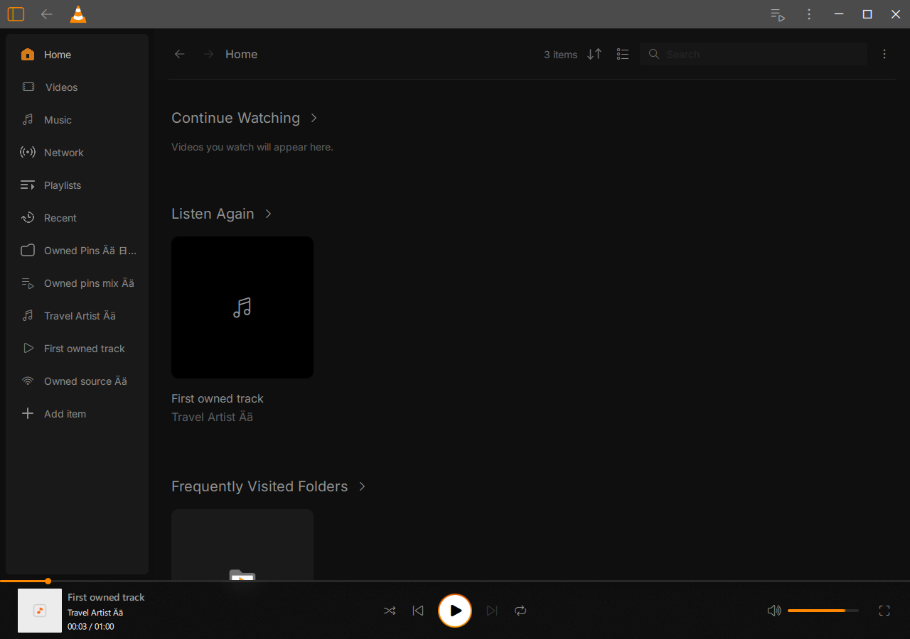
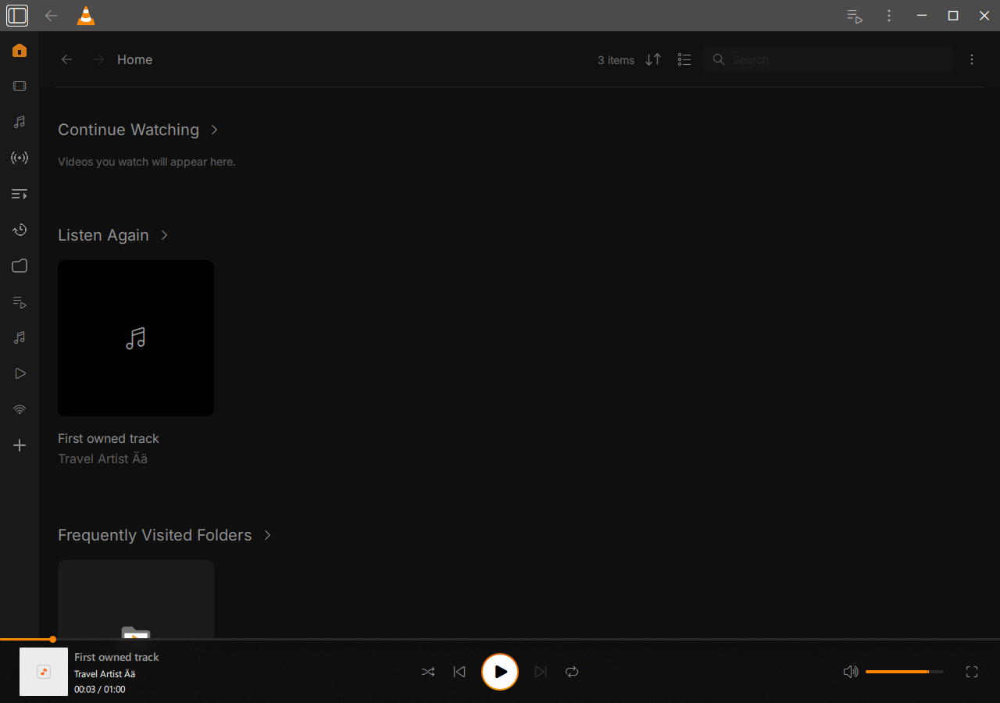
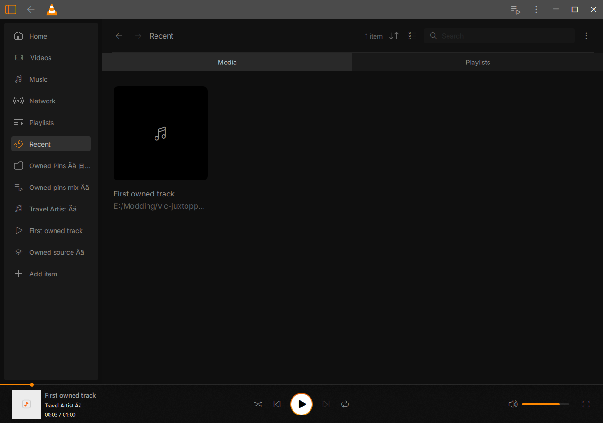

# Guest sidebar shell/Home/Recent — 18 October 2026

Scoped progress toward the complete confirmed redesign. Full sidebar fidelity,
Recent and beta acceptance remain open. All project data stayed on E:. One
build/native playback job ran at a time, with one worker and CPU-only WSL.

## Implemented and verified

The sidebar now follows original 217/50px expanded/compact geometry,8px outer
inset,16/12px expanded panel padding,6px corner radius,32px rows,14px gaps and
14px Inter labels. The missing Home and Recent entries are present. The provisional
bottom Preferences row is removed; the existing app/keyboard Preferences routes
are unchanged. Six unchanged24px original SVGs supply Home active/inactive,
Network, Playlists, Recent and Add, with the original reflections and native
runtime palette colors. [Assets](assets.json) records exact bytes and slots.

Recent's Media tab uses the real paged MLRecentMediaModel, including local audio
and native stream history. Password-free native source locations distinguish
similarly named entries. The Playlists tab uses actual successful playlist visits,
ranked by last activity rather than visit frequency. Activations preserve typed
native IDs. Both tabs have real history leaves, so Back/Forward restores the tab.
The Recent page itself is not shown in retained references; its tabs/content are
a provisional functional composition of existing library controls, not an
independently accepted original page design.

Fresh native populate/reopen/disabled/replacement passes 298/178/101/106
(**683 checks**) normally, with no forced cleanup, selected diagnostics or Qt
warning lines. It covers actual app-toggle217→50→217, exact paused input/time/
position preservation, Home return, real media and playlist activation, native
Back/Forward and decoded loopback HTTP playback reopened through Recent. The
cold case verifies cleared history remains empty, then a normal native stop
commits fresh activity and updates the visible model. Library-OFF cases cover
pins/toggles and explicitly do **not** accept Recent in that state.

Ordinary modern/traditional/library/local-HLS/Downloads replay passes five cases,
all normal exits and zero Qt warning lines. Generated media, previous runtime and
the Downloads sample stat are unchanged. The ordinary GUI contains no private
journey, HTTP-test or temporary SVG diagnostic marker. Current ordinary GUI:
`e5e68bf79d508884cef71ab738dfbfd3e4ed9a327bec4f7d9d325a8c702c1491` (105,509,634 bytes). Core0cdebe and MLe3ec5e are unchanged.
All 1924 production/five private/nine component inputs match; prior 458 Core
and 8 store inputs remain unchanged. Pin component21 and navigation route/focus/
scale checks pass. The retained Home component/recency check used unchanged inputs.

## Negative and rejected evidence

The old geometry fails the new compact-row check. The pre-fix footer fails the
14px gap assertion; corrected expanded/compact components pass. Native screenshots
also exposed white default tabs in Dark mode; explicit palette styling fixes them.

Private R1 quit normally after 204 checks but failed its test-only QML evaluation
of an internal id. R2 uses the actual GridView's public methods. R2 populate passed 282,
including decoded HTTP reopen, but its cold case incorrectly expected history
before a new commit after the preceding explicit privacy clear. R3 verifies the
true empty→normal-stop→populated transition. R4 adds actual app toggle interaction
and explicit unaccepted Library-OFF status. Rejected reports, source snapshots,
binaries and full owned logs remain in `build-windows/beta-sidebar-shell-20261018`.
Neither failed expectation is claimed as a production fix or complete acceptance.

## Remaining work and reproduction

[Remaining gates](remaining.json) are part of the original beta goal. Most urgently,
connect the existing lazy history-only backend to Recent while Library browsing
is OFF; vlc_ml_instance_get intentionally remains null there. Preserve the
no-indexing/metadata/discovery policy and side-effect-free capability probe.
Two original Videos/Music icons are also unresolved: the parent export supplies
a gear for both, despite different folder icons in its screenshot. The agreed
8+2 reference budget is exhausted; an additional two-read question is pending.
The current filmstrip/note glyphs are functional provisional fallbacks and do
not establish original icon fidelity. Canonical IDs 71:857/71:851 are already
present in cached metadata. No extra MCP reads were made.

Broader Recent selection/search/sort/error/privacy states, activity DB identity,
full shell/title strip, native picker/protocol/drop variants, themes/System/fonts/
accessibility/DPI/monitors, independent fidelity, Windows11 and a clean licensed
package remain open. Earlier backend/controller results retain their earlier GUI
scope. This checkpoint cannot complete the beta goal.

[Reproduction](reproduction/) retains one-worker build and owned runners. Read the
guest setup and dot-source Common.ps1. The maintained sidebar_pins_journey.mk
builds the private module; --recent-stream enables only an owned127.0.0.1 server
serving generated media. Never ship that private module. Exact frozen source and
runtime identities are in [results](results.json). The original [reference image](reference/sidebar.png)
and cached code are evidence only; no reference media was installed as UI content.

