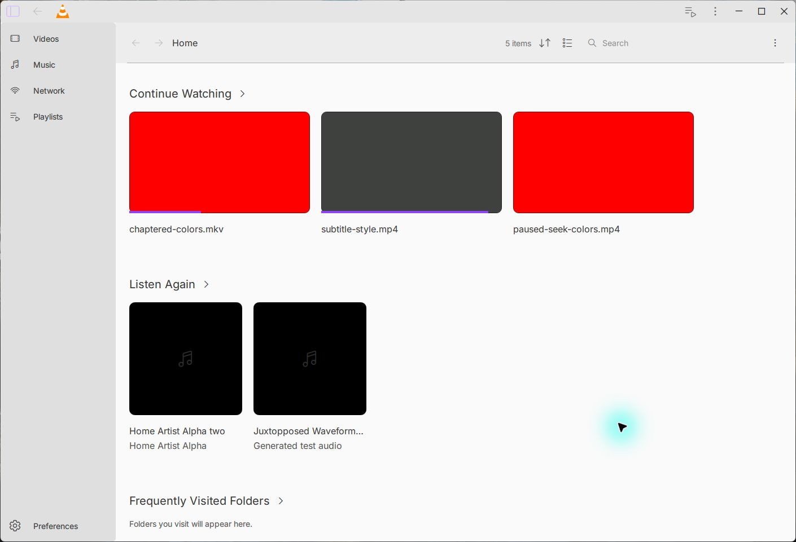
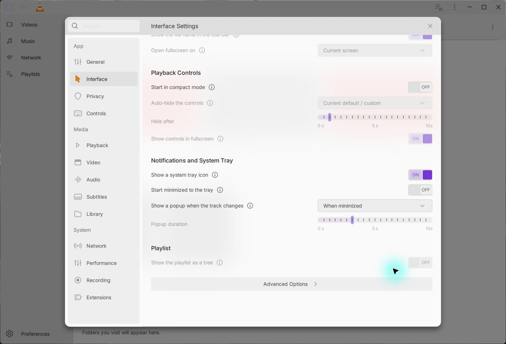

# Native Interface settings checkpoint — 15 October 2026

Preferences now opens a separate native Interface page with all 18 authored
values. Eight controls explicitly remain unavailable pending their real consumer
acceptance. Existing native controls save through the same checked transaction
as General. The shared store is extracted without changing General's public API.

The ordinary Windows build and registered Interface native fixture pass all
14 QTest cases/rows (including setup and cleanup). These cover five existing
native flags, strict types and unsupported writes, a Unicode skin path, native
save failures, a real Windows locked destination with unchanged previous bytes
and successful retry, and borrowed-settings lifetime. Selecting a readable skin
file does not prove that the skins2 parser accepts its contents.

The original private General desired/policy objects were relinked against the
actual production General/store objects. They pass 29/0/1 and 31/0/1; the separate
required sync/close-fault run passes 3/0/0, including setup/cleanup. The ordinary
runs deliberately skip the injected-fault case. These are private replay
fixtures, not a newly tracked or registered General test suite. Fault libraries
are confined to that private test runtime.

A registered, explicitly invoked hidden QWindow fixture passes six QTest cases
(four substantive methods) against real connected QScreens. This does not accept
visible fullscreen placement, DPI changes or hot-unplug behavior. Its app
consumer gate remains disabled.

The same 25-case Qt QuickTest oracle exposes two failures in the original
toolbar transition: a revealed windowed toolbar hides on the next timeout even
when auto-hide is off. Targeting the actual visible/audio state fixes both
failures. All 25 cases now pass against production FSM/helpers, including real
0/777/10000-ms timers, with explicitly supplied Player/MainCtx boundary state.
The oracle and boundary files are unchanged and promoted to maintained CI.
This component result does not accept new native app auto-hide modes.

Production component replays pass Interface 10 groups, General 12, shared host
24 checks/12 transitions/9 busy guards, and software backdrop 23 checks, without
Qt messages. Four actual app journeys quit normally (0), finish the Qt UI
thread, and preserve the checked human VLC configuration. The desktop saves
standard window decorations, restores them after restart, then saves and
restores the custom title bar. It also rejects missing/empty skin edits,
preserves and restores a Unicode file path, switches Dark/Light and reaches the
lower sections. The final taller viewport is an explicitly seeded owned test
profile, not evidence of native resizing. An evidence-saving closure initially
saved stale images in the first final-build run. Those captures are invalid and
excluded. The replacement run uses explicit current-state captures, confirms the
window identity and monitor bounds, and preserves three distinct original PNGs.

Original Interface frame `3046:10057` comes from [Juxtopposed's Figma design](https://www.figma.com/design/zdNUYRVOH9lEtIxMYvh8DV/VLC-Redesign--Community-?node-id=3046-10057).
The two newly included tick SVGs retain the exported bytes; the page reuses
19 existing original assets. The existing designer attribution, CC BY 4.0
notice and Inter OFL materials apply. This implementation is not affiliated
with or endorsed by the designer.

Actual skin picker/parser, tray interactions, newly gated consumer journeys,
other DPI/screens, full Figma fidelity and the full beta remain open. All four
jobs on preceding geometry head `ba175cfc69` passed. This checkpoint adds two
Windows CI commands (25 total); its exact-head CI must be checked separately.

[Dark lower sections](assets/interface-dark-lower.png) · [Sanitized verification](verification.json)
