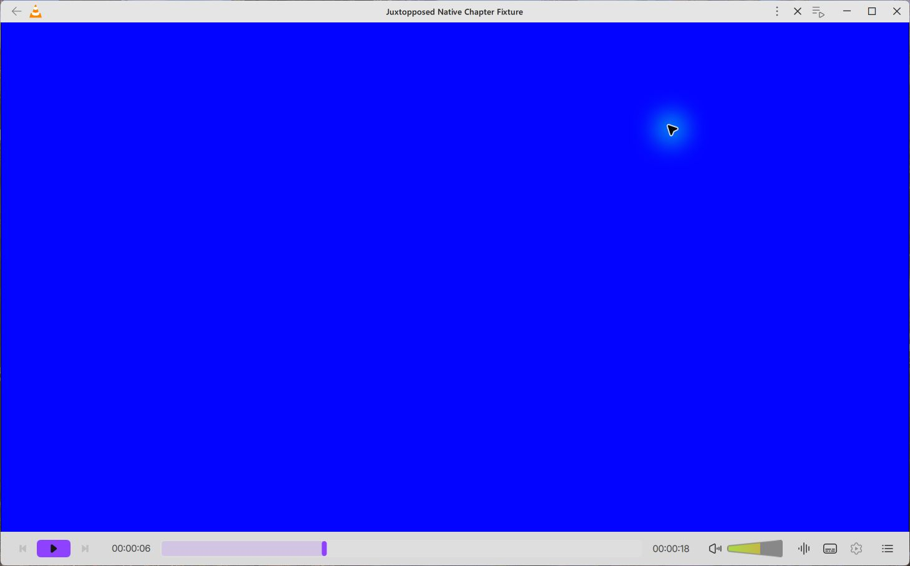
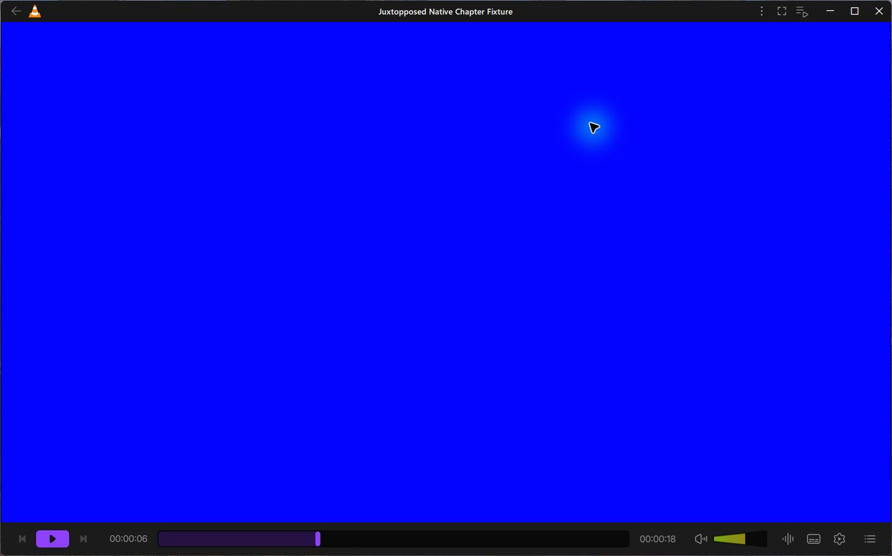

# Original Light volume artwork — 15 October 2026

The Light player now uses Juxtopposed's original Light volume background and
complete fill. Dark retains its original artwork. The fill remains 86px wide
and clips to VLC's actual 0–200% volume; the previously cached 53px fragment is
not stretched or shipped as the complete fill.

The unchanged original exports are background `I2425:13645;491:1733;244:226`
(89 × 27.3633) and full fill `I2425:13645;491:1733;244:229` (86 × 24.56), from
Figma Player - Light `2425:13624`. The full fill's SHA256 is
`42f2d84432e72181741087119cc0212e4489433d720b121bce42b95ebf873eee`.
Original artwork and the small test reference retain Juxtopposed's attribution
and CC BY 4.0 license. No SVG paths or pixels were redrawn.

The registered Windows Qt build exits 0, with DLL SHA256
`fe51d7cca8d41c2e3ebc7fd0e68cc5da0f1db6668916609cbeaa4a638f5684c8`.
Its new plugin tree and cache are staged separately, preserving the earlier
working trees and attribution. The actual app on monitor 2 changed volume from
100% to 65% by pointer and to 70% by Ctrl+Up. Mute retained 70%; volume-wheel
input changed it to 75% and unmuted playback. Switching Dark and back to Light
preserved 75% while the artwork changed live. Native OSD and accessibility values
confirmed the engine updates. The app quit normally with exit 0 and confirmed
process termination; the checked existing human VLC configuration stayed
unchanged. The surrounding wait-script duration is not a quit-latency measure.

The maintained actual-production component suite passes seven groups with no
Qt messages, including teardown. It checks original SVG/PNG identities, rendered
colors, complete artwork/clipping at five volume levels and three scales, real
QML keyboard/wheel/pointer handling and the extracted native write/unmute contract.
Its narrowly historical control changes only the two old asset expressions.
Reverted Light selection and a modified reference PNG fail the strict oracle;
harmless application-code edits do not fail a pinned code hash. Existing playback
regressions and 43 appearance checks pass separately.

CI preserves the preceding 21 Windows commands and Linux make job, and adds this
one volume step. Both Windows and both Ubuntu jobs for the preceding General
head `a8688e13fa2739203093b1f78a01c946e0f661a2` passed through Code Review; new-head
CI remains a separate gate. [Verification and source identities](verification.json)
exclude raw logs, profiles, private media and launch receipts.

These bounded checks do not accept the complete Light player, System-theme OS
events, every DPI/window state or final package. Settings backdrop blur remains
unintegrated: its native periodic-pattern test exposed residual striping. A
corrected consumer passes the same original native shader fixture, including
25px/37.5px transitions and teardown; full app/video acceptance remains pending.
The remaining settings categories and full beta gates stay open.
