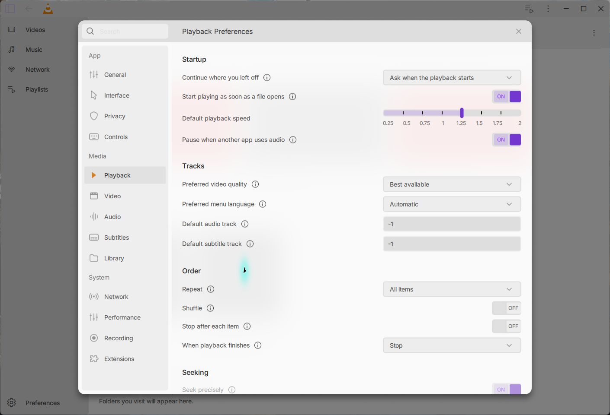
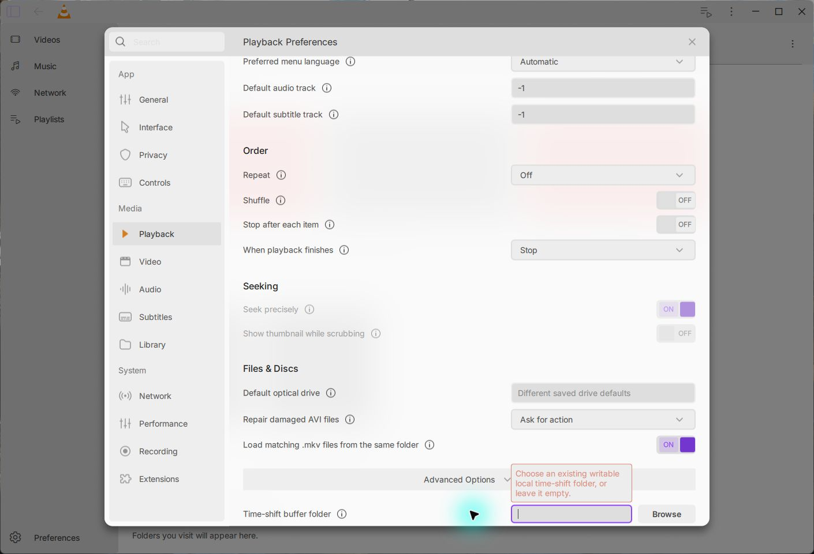

# Native global Playback settings — 15 October 2026

Preferences now exposes the separate 19-value Playback page, including the two
authored time-shift rows behind Advanced Options. Controls use native values,
checked writes, live playlist/player policies and accurate restart feedback.
The precise-seek capability remains gated; timeline thumbnails remain unavailable.
General and Interface retain their existing models and shared modal ownership.

The ordinary Windows build succeeds. Its registered native Playback fixture
passes **23/0/0**, including setup/cleanup, with a genuine isolated VLC
playlist/player and ordinary core. It checks strict types and native choices,
independent repeat/loop bits, live shuffle/start-paused/stopped-action policies,
track indexes and ID overrides, menu language, mixed optical defaults and
time-shift bytes/directories. Four saved rates survive native teardown and a
fresh player. Three actual Windows locked-save cases preserve old disk/model/
live state and recover on retry: track integers, live shuffle and float rate.
The test-only precise-seek override verifies the native flag/helper, not all
six Qt callsites or a fast/precise media comparison.

Compilation needed local declarations for the existing lock template and an
explicit QString materialization for the unchanged missing-folder assertion.
The failed build attempts are retained privately. The final QML-only rebuild
retains the same native executable and C++ inputs as the successful 23-case run;
the verification records both ordinary Qt identities accurately. No injected
core is used in these app or Playback fixture runs.

An actual desktop failure exposed invisible validation feedback when the
Advanced folder row was scrolled down. The same additive component worker
passes its original 14 groups on the old code, then rejects the missing
in-viewport error. The correction preserves all 83 original assertion segments
and both supplied provider classes, and passes **15 groups** with no Qt messages.
It checks the error and focused field against the real viewport at natural,
narrow, 150% and 200% component layouts. The persistent non-focusing error uses
the native lastError, without changing normal authored geometry or validation.
The actual final Windows app repeats the rejected Return, restores the previous
folder and visibly shows the error beside the focused input. Search focus hides
the inline feedback and Escape closes the dialog normally.

Other production component checks pass General 12, Interface 10, shared host
24 checks/12 transitions/9 busy guards and software backdrop 23, with no Qt
messages. Three desktop journeys exit normally (0), finish the Qt UI thread and
preserve the checked human VLC files, all on monitor 2 at DPR 1.

The desktop saves default speed 1.25× and Repeat All, then restores both after
restart without a restart warning. The real main player shows 1.25× and its
queue reports Repeat All. Saving a new 1× default leaves the current media at
1.25×; Repeat Off reaches the actual queue immediately while it stays paused.
The next app launch restores the 1× default. In the final build, pointer seeks
move the generated clip from paused blue to red and back to blue, with actual
positions about 0.398 → 0.201 → 0.481 and pause preserved. This is bounded native
seek coverage, not acceptance of every new seek callsite/mode.

Original design and artwork: [Juxtopposed](https://www.youtube.com/@juxtopposed),
Figma [closed frame `3062:12552`](https://www.figma.com/design/zdNUYRVOH9lEtIxMYvh8DV/VLC-Redesign--Community-?node-id=3062-12552)
and [expanded frame `3072:13408`](https://www.figma.com/design/zdNUYRVOH9lEtIxMYvh8DV/VLC-Redesign--Community-?node-id=3072-13408).
Six additional SVGs retain the original exported bytes. The existing designer
attribution/CC BY 4.0 notice and Inter OFL remain packaged. No designer
endorsement is implied.

An intermittent startup text-painting issue remains open: two earlier launches
show missing Home glyph fragments until settings causes a repaint. The final
launch is clean, but no cause or repair is accepted. Compare the unchanged
[earlier capture](assets/startup-glyphs-pending.png) and [later startup](assets/later-startup-clean.png).
Broader Light queue styling also retains its existing full-fidelity gate.

Actual folder-picker behavior, communication ducking, track/disc/rendition and
AVI/MKV/time-shift media behavior, full resume/privacy policies, native precision
mode comparisons, thumbnails, other DPI/screens, full Figma fidelity and clean
beta packaging remain open. All four jobs on preceding Interface head
`04189f5271` pass (25 Windows commands, two Ubuntu workers). New-head CI must be
checked separately; this checkpoint adds Windows command 26.

[Current speed preserved](assets/current-speed-preserved.png) · [Paused red](assets/paused-red.png) · [Paused blue](assets/paused-blue.png) · [Sanitized verification](verification.json)
