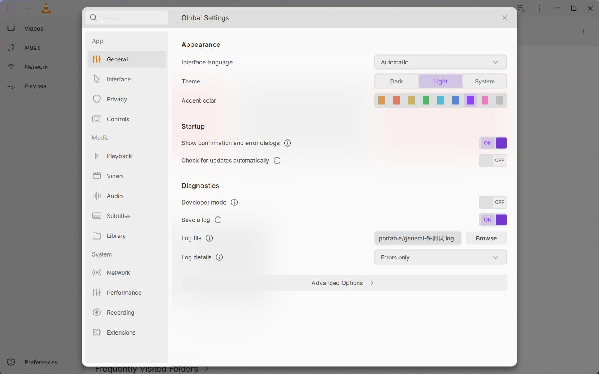
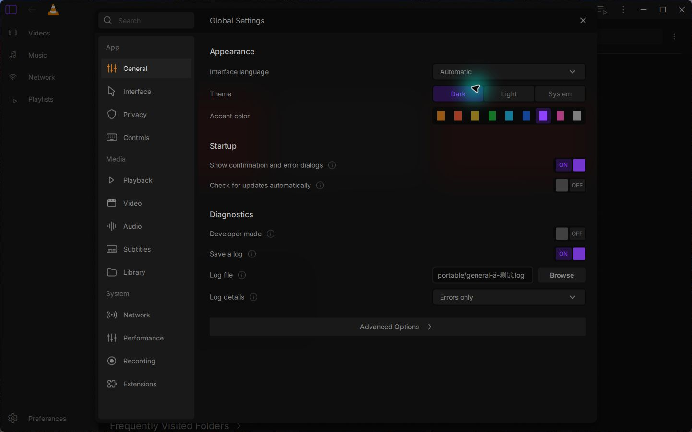

# Settings backdrop and incremental QML packaging — 15 October 2026

Global Settings now captures the actual underlying Qt Quick view for its
backdrop, with the original 95% tint, 14px corners and 0/8/15px shadow. The
existing Dual Kawase shaders approximate the Figma 25px Gaussian blur; no
pixel-identical Gaussian claim is made. Closing the dialog unloads its effect.

The first native periodic-pattern test exposed residual stripes. A native-density
capture followed by the existing six-pass filter passes the **same compiled
desired fixture and all 39 original assertions**, including dirty source changes,
foreground exclusion, rounded crop, shadow and actual engine destruction.
On D3D11 at DPR 1, stripe variation is zero and measured transition widths are
67px at scale 1 and 99px at scale 1.5. The fixture uses the real native texture
observer/shaders and only supplies the DPR service boundary. It does not render
VLC video or instantiate MainCtx.

The actual Windows app on monitor 2 shows the backdrop over Home in Light and
Dark, changes tint live, closes and reopens. Native video exposed a separate
compositor limitation: the embedded video surface is outside Qt Quick's capture.
The app therefore retains the original translucent tint while embedded video is
active. Native paused red-to-blue seeking and Light/Dark video tint checks pass;
**hardware-video blur is unfinished**. No replacement video image is fabricated.
Both native app runs terminate normally with exit 0 and preserve the checked
existing human VLC settings. Wait-script durations are not quit latency.

The first registered build also exited successfully with stale generated QML
metadata and then failed at startup because its new types were absent. The old
warm dependency recipe can update the main Makefile while retaining an unchanged
included file, leaving GNU make's loaded source list stale. The narrow repair
always atomically replaces a remade dependency include. Per-module list stamps
still avoid unrelated resource rebuilds.

Actual GNU Make 4.3 paired tests retain one desired metadata-closure oracle:
the frozen old recipe exits 0 with only the old type and **fails** that oracle;
the corrected recipe includes every new QML/JS/MJS/singleton export, resource,
response entry and member. A deliberately missing stamp dependency still fails
at the newly added resource. The earlier eager-dependency pair remains unchanged
and passes separately. These are real generator/make tests with explicitly
substituted compiler/library metadata probes, not native archives.

Maintained General (12 groups), shared dialog host (24 checks, 12 transitions,
nine busy guards) and backdrop software fallback (23 checks) pass with zero Qt
messages. Software checks accept tint, updates and lifecycle only. All original
General/host behavior assertions and providers remain. CI preserves 22 preceding
Windows commands, adds the software-backdrop check and adds the warm-list pair
to the Ubuntu make job.

The source and native evidence here accept these bounded changes. Hardware video
blur, performance/DPI coverage, complete native Figma fidelity, the remaining
settings categories and the final reproducible beta package remain open.

Original design: [Juxtopposed](https://www.youtube.com/@juxtopposed), Figma General
`999:5047`; original artwork/Inter notices remain preserved. Public records exclude
raw logs, profiles, private media, picker captures and local identifiers.

The final ordinary Qt rebuild also opens Home/General, closes and terminates normally.
Its DLL SHA256 is `1f8056853763bc7d11b8e0faaa6ac6a18a66519de48c83a6958d2ee5ff2688f6`.

[Light native-video tint fallback](assets/light-video-fallback.png) · [Dark native-video tint fallback](assets/dark-video-fallback.png) · [Final packaged types](assets/packaging-fixed.png) · [Sanitized verification](verification.json)
