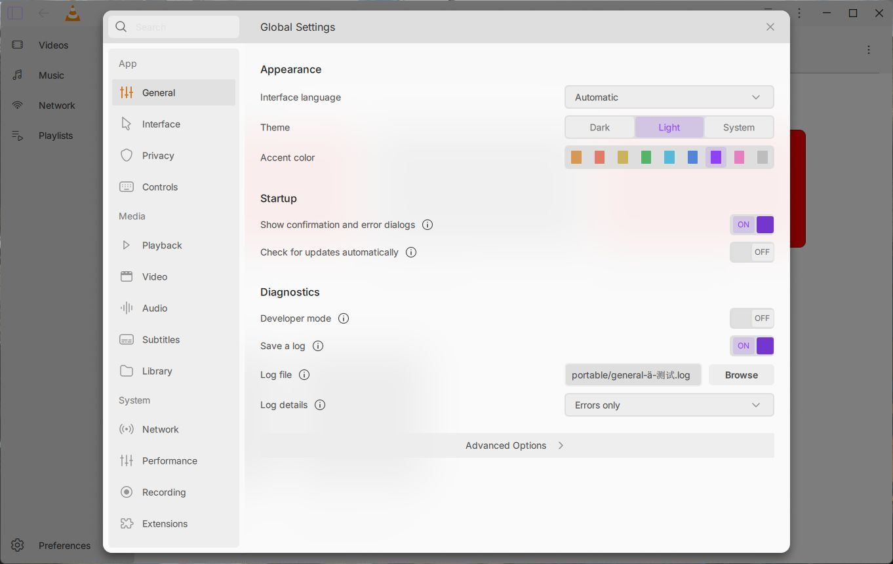
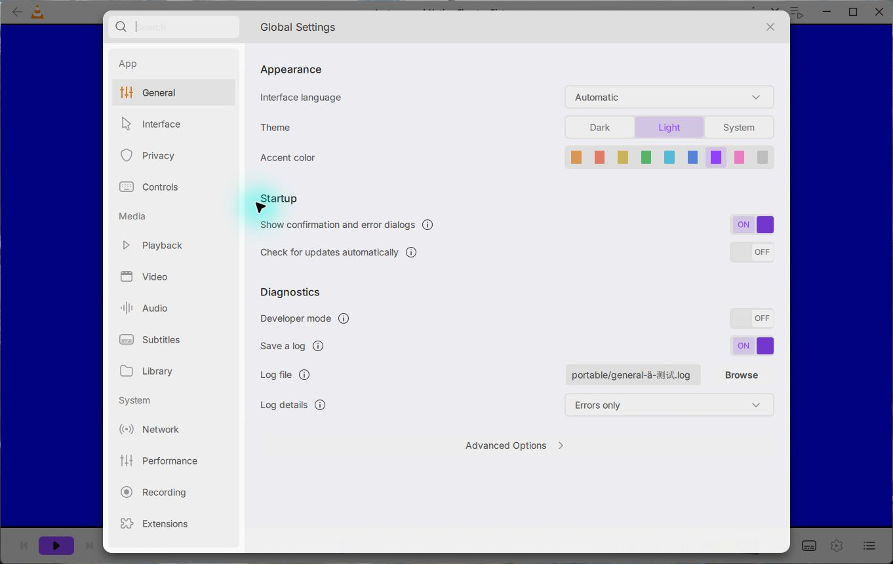
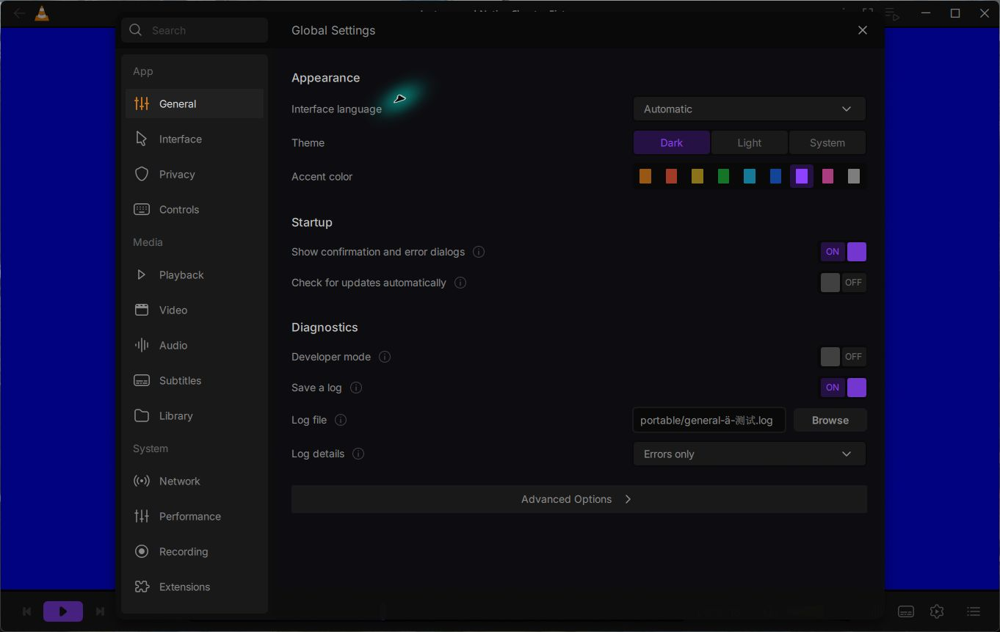

# Independent settings shadow — 15 October 2026

The original settings shadow now renders independently of the Home capture.
The ordinary Windows app shows the Light Home blur and shadow, and retains the
shadow in both Light and Dark above an actual paused generated video frame.
The original shadow parameters are unchanged. Video keeps the translucent tint
fallback; capturing and blurring VLC's separate hardware-video surface remains
unfinished.

The same original native shader fixture passes all 39 assertions, with zero QML
warnings and checked engine/root destruction. Its synthetic stripes measure zero
remaining range and transition widths 67/99 at the two tested scales. This is a
real Qt shader/observer test, separate from the actual VLC app journey.

Maintained General, shared-host and software-backdrop checks pass 12/24/23 with
no Qt messages. Software rendering creates neither GPU effect loader. The first
single ordinary rebuild after adding the new Shadow QML type generates and
compiles it successfully, providing native confirmation of the preceding warm
QML packaging repair without manual stamp changes or a second build.

The actual app restores Light, closes settings and quits normally with exit 0;
the checked human VLC settings stay unchanged. The flushed log records the Qt
UI thread finishing and no checked startup/QML error patterns. This is not a
quit-latency, DPI, performance or complete design-fidelity acceptance claim.
All four CI jobs on preceding head `c736003b53` passed; this checkpoint's CI must
be checked separately. Full beta acceptance remains open.

[Sanitized source and verification identities](verification.json)
