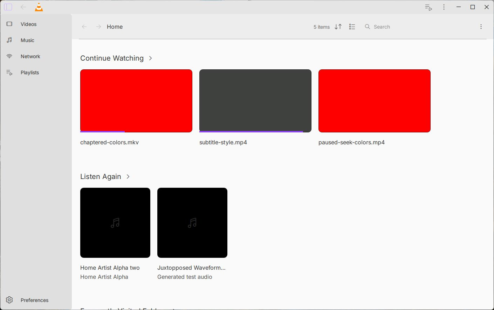

# Preserve the saved Windows client size — 15 October 2026

The window now restores its saved client rectangle after Windows finishes
initializing the native title-bar frame. This fixes the observed shrink on each
launch. The original serializer, generic-platform constructor signature and
geometry values are preserved; no fixed pixel compensation is added.

Two original native runs lose 16 pixels of client width and 8 of height on each
restart. The same desired oracle passes two corrected runs from the same initial
saved 1408 × 884 client rectangle, with exact client size and position preserved.
Two further native restarts with the standard Windows title bar also pass. The
private diagnostic builds use the actual configured Qt object graph with four
instrumented objects; the candidate uses the newer dialogs archive containing
the independent settings shadow. Neither Home-only pair opens settings.

An actual pointer/keyboard journey verifies maximize, fullscreen from maximized,
return to maximized, restore normal, fullscreen from normal and return to the
original normal geometry. Native Qt state traces confirm the sequence and the
final exact saved rectangle, all on monitor 2 at DPR 1.

The ordinary build includes only the three production source changes, with no
diagnostic collector. It opens Home twice, captures the same bounds, preserves
the exact saved geometry payload through both normal quits, and records the Qt
UI thread finishing without checked QML errors. All seven corrected app runs
exit normally (0) and preserve the checked human VLC settings. The failing
baseline runs are retained separately as meaningful controls.

This does not accept other DPI/screen changes, missing or invalid saved geometry,
start-minimized/on-top behavior, complete Figma fidelity or the full beta. All
four CI jobs on preceding shadow head `23700d1dec` passed; this checkpoint's CI
must be checked separately.

[Fullscreen journey](assets/fullscreen.png) · [Sanitized verification](verification.json)
